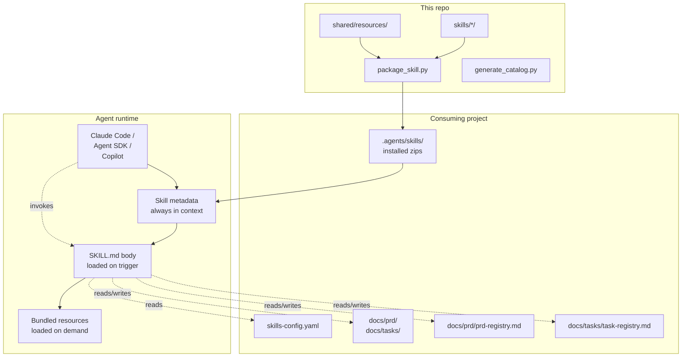
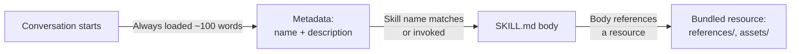
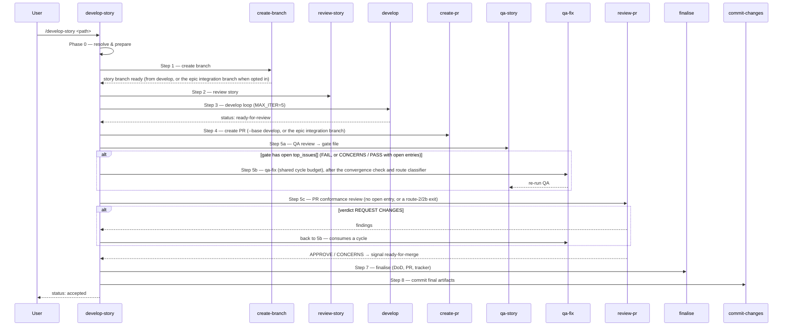
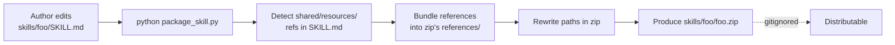
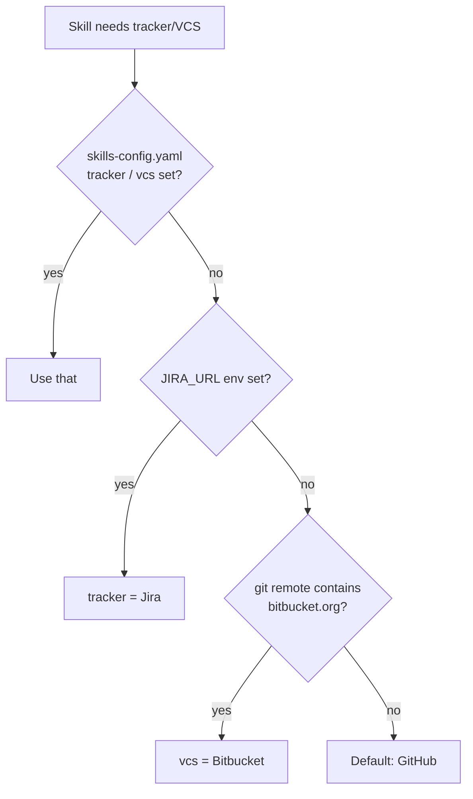

# Architecture

> **Audience:** anyone wanting to understand how the library fits together.

A library-level view: how skills are loaded, packaged, invoked, and how they interact with each other and the consuming project.

## System overview

**Three boundaries:**

- **This repo (`agent-skills`)** authors and packages skills. It is _not_ installed into target projects.
- **Consuming project** has a `skills-config.yaml`, an `.agents/skills/` directory of installed zips, and project docs the skills read/write.
- **Agent runtime** loads the skills' progressive-disclosure tiers as needed.

## Progressive disclosure

Three tiers, loaded as relevance grows:

1. **Metadata** — `name` + `description` from every skill's frontmatter, always in context. ~100 words total. Powers auto-activation.
2. **SKILL.md body** — loaded when the skill triggers. The full instructions for that one skill.
3. **Bundled resources** — `references/` and `assets/` inside the zip. Loaded only when the body references them.

The cost ladder is steep: skipping tiers 2–3 for skills you don't need keeps the context window usable.

## Orchestrator → leaf skill dependency map

```mermaid
flowchart TD
    DS[develop-story] --> CB[create-branch]
    DS --> RS[review-story]
    DS --> DEV[develop]
    DS --> CPR[create-pr]
    DS --> QS[qa-story]
    DS --> QF[qa-fix]
    DS --> RPR[review-pr]
    DS --> FN[finalise]
    DS --> CC[commit-changes]

    DT[develop-task] --> CB
    DT --> RT[review-task]
    DT --> DEV
    DT --> CPR
    DT --> QT[qa-task]
    DT --> QF
    DT --> RPR
    DT --> FN
    DT --> CC

    CS[create-story] --> DSV[documentation-<br/>standards-validator]
    CS --> MA[mermaid-architect]
    CS -->|UI stories| WF[wireframe]
    CS --> EGH[ensure-epic-github-issue]
    CS --> EGJ[ensure-epic-jira-issue]
    CS --> ESGH[ensure-story-github-issue]
    CS --> ESGJ[ensure-story-jira-issue]

    RS --> EGH
    RS --> EGJ
    RS --> ESGH
    RS --> ESGJ
    RS -->|UI stories| WF

    CE[create-epic] --> ERM[doc-id.js<br/>epic.P.E allocation]
    CE --> DSV
    CE --> MA
    CE --> EGH

    CPRD[create-prd] --> CD[create-doc]
    CPRD --> PMC[pm-checklist]
    CPRD --> BPT[brownfield-prd-template]
```

`create-story` and `review-story` ensure the epic's tracker issue, picking `ensure-epic-github-issue` or `ensure-epic-jira-issue` through the [platform resolver](../../shared/resources/platform-detection.md). `create-story` does the same for the story issue with `ensure-story-{github,jira}-issue`. `create-epic` calls `ensure-epic-github-issue` when you choose to sync the new epic to GitHub; on Jira it hands off to `sync-jira-epic`. `finalise` calls none of them.

## Pipeline phases (story)

**The loop routes on the gate's open findings, not its verdict token.** A gate with no open
`top_issues[]` entry (`PASS`, `CONCERNS` or an active `WAIVED`), or a Diminishing-returns (route 2)
or Cosmetic-residue (route 2b) exit, hands to **Step 5c**; only `FAIL`, or a gate with open entries,
goes to `qa-fix`. 5c, the PR conformance review, is the only way out to Step 7: `REQUEST CHANGES`
routes back to `qa-fix` and consumes a cycle from the same budget (`QA_MAX_CYCLES`, default 5), while
`APPROVE`/`CONCERNS` exit and signal `ready-for-merge`. The routes and guards are defined in the
Step 5–6 doc linked below. 5c is a third member of a loop that already had two — the pipeline is
still eight steps.

Reference: [`skills/develop-story/README.md`](../../skills/develop-story/README.md) and
[`shared/resources/develop-pipeline-step-5-6-qa-loop.md`](../../shared/resources/develop-pipeline-step-5-6-qa-loop.md).

## Packaging flow

Self-contained zips mean consuming projects don't need to install `shared/resources/` separately. The packager guarantees every reference resolves inside the zip.

## Platform resolver

Canonical: [`shared/resources/platform-detection.md`](../../shared/resources/platform-detection.md).

## Design principles

The architecture above reflects a small set of design choices:

- **Bounded loops** — never let an LLM loop indefinitely. MAX_ITER=5 on develop and qa-fix.
- **Gate ownership** — QA outputs (`*.gate.*.yml`) are owned by QA skills. Dev skills never write them.
- **Idempotent resume** — re-invoking an orchestrator picks up at the first incomplete step. No "should I redo this?" prompts.
- **Self-contained packaging** — installed skills carry their shared resources. No runtime dependency on this repo's layout.
- **Atomic registry updates** — new epics/tasks and their registry rows commit together.
- **Co-location** — plans, artifacts, and review reports live next to the work, not in scratch dirs.

See also [FAQ](../reference/faq.md) for the rationale behind each.

## See also

- [Overview](./overview.md) — what skills are
- [Getting started](./getting-started.md) — install and first command
- [FAQ](../reference/faq.md) — why the design works this way
- [Anti-patterns](../reference/anti-patterns.md) — what to never do
- [`develop-story` README](../../skills/develop-story/README.md)
- [`develop-task` README](../../skills/develop-task/README.md)
