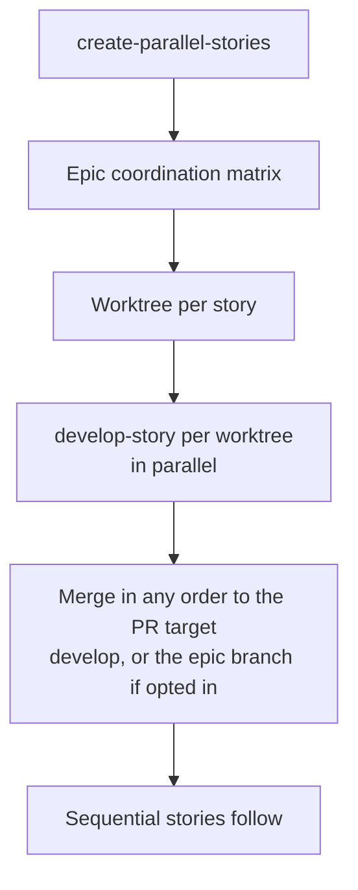

# Runbook — Parallel Story Development

> ### Is this the right runbook?
>
> **Use this if** you have 2+ developers (or 2+ agent sessions) shipping interdependent stories simultaneously.
>
> **Use a different runbook if:**
> - You're alone, shipping one story end-to-end → [`story-development.md`](./story-development.md)
> - The work is internal and not user-facing → [`task-development.md`](./task-development.md)
> - You're not sure → [decision tree](../concepts/which-path.md)

---

> **Audience:** teams developing multiple stories of one epic simultaneously without merge conflicts.

> ⚠️ **Epic 3.2 pending:** An advanced multi-team and cross-epic coordination guide will link here once Epic 3.2 lands. The steps below cover single-repo parallel stories within one epic; Epic 3.2 will extend this to larger-scale parallel patterns.

When several stories under the same epic can be implemented in parallel — different files, different concerns — use Git worktrees to isolate them and let multiple developers (or multiple agent sessions) work at the same time.

## When to use this runbook

- Two or more sibling stories under the same epic have **no file overlap**.
- You want to ship stories out of dependency order.
- You're running multiple agent sessions and need isolation.

If stories share files, do not use this runbook — sequence them via the normal [Story Development Runbook](./story-development.md).

## Prerequisites

- Git worktrees are available (`git worktree --help` succeeds).
- Stories are already authored and reviewed (`status: ready-for-development`).
- File boundaries between stories are explicit — list them up front.

## Pipeline



## Steps

```
1. /create-parallel-stories <epic-path>     → produces coordination matrix + worktree setup commands
2. For each parallelisable story:
   git worktree add .worktrees/story-{E}.{S} -b story/{P}.{E}.{S} develop   # a scratch branch, not the feature branch
   cd .worktrees/story-{E}.{S}
   /develop-story <story-path>
3. Merge each story PR to its target as it lands (any order): `develop` by default, or the epic
   integration branch when the epic opted in.
4. After all parallel stories merge, sequential stories proceed normally.
```

`-b` names a **scratch** branch for the worktree. `/develop-story` cuts `feature/story.{P}.{E}.{S}.{name}` itself, from `origin/<Q1 base>` (normally `develop`, or the epic integration branch when the epic opted in), inside the linked worktree (`/create-branch` Step 5, linked-worktree exception). Pre-creating the feature branch there makes Step 1 stop on "branch already exists", and omitting `-b` fails because no such branch exists yet. This is the same shape `/develop-batch` uses.

The setup commands `/create-parallel-stories` prints (`git worktree add .worktrees/story-1-1 -b feature/story-1-1-1`) work too: their `-b` name is also a scratch branch, and it does not collide with the `feature/story.{P}.{E}.{S}.{name}` branch `/develop-story` cuts, because the names differ. They name no base, so the branch is cut from whatever is checked out; run them from `develop`. The form in step 2 is the same command with the base named. Either way, delete the scratch branch after `git worktree remove` (see Pitfalls).

## Pitfalls

- **Don't share dirty worktrees across agent sessions** — each session needs an isolated checkout.
- **File-boundary discipline is on you.** `create-parallel-stories` produces a coordination matrix; respect it. If a story's diff touches files claimed by a sibling, abort and re-sequence.
- **Each PR targets the base chosen at `/develop-story` Phase 0 Q2** — `develop` by default, or the epic integration branch when the epic opted in with `branch_model: epic-integration`. Same convention as serial development.
- **Worktrees go inside the repo, never beside it** — under `.worktrees/` (or `developBatch.worktreeRoot` in `skills-config.yaml`), which must be gitignored. A sibling directory is invisible to the repo's `.gitignore` and lands wherever the clone happens to sit.
- **Worktree cleanup:** after merge, remove the worktree and its scratch branch (`git worktree remove .worktrees/story-{E}.{S}`, then `git branch -D story/{P}.{E}.{S}`). Do the same before re-running the setup for a story whose run was discarded: `git worktree add -b` fails when the scratch branch already exists.

## See also

- [`create-parallel-stories` SKILL.md](../../skills/create-parallel-stories/SKILL.md)
- [Story Development Runbook](./story-development.md)
- [Sprint Cycle Runbook](./sprint-cycle.md)
