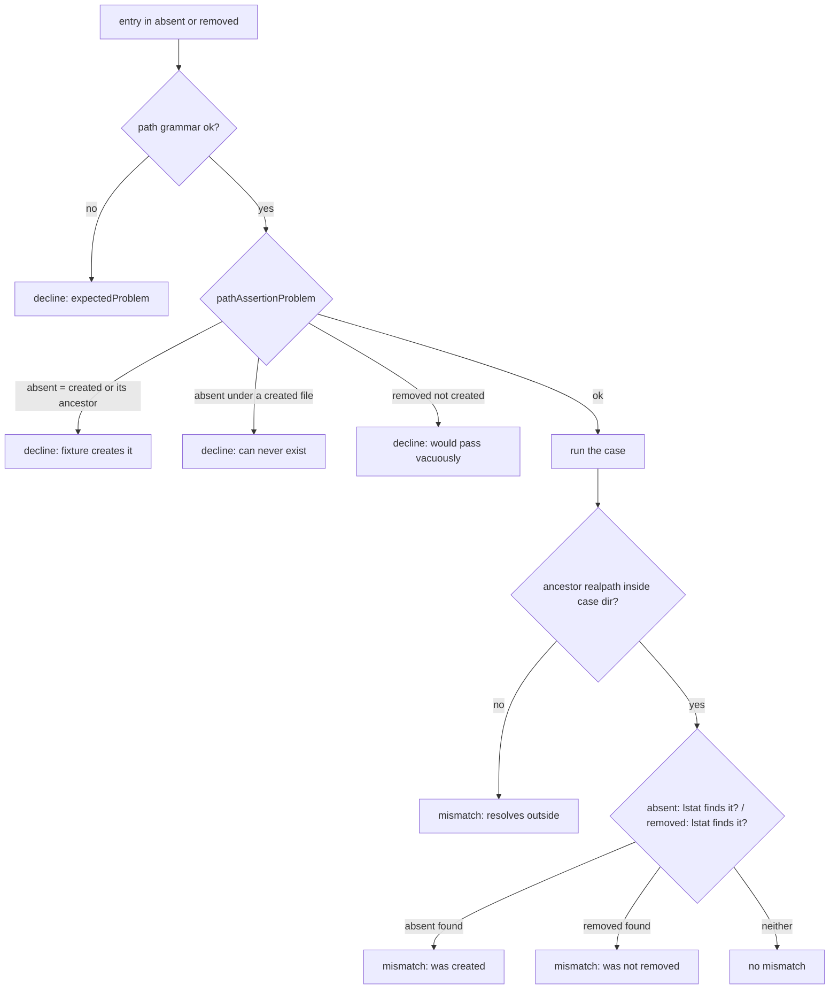

# Technical Task: Probe path assertions — nested `absent` and a new `removed`

**Status:** Ready for Development
**Review**: ✅ All review recommendations from `task.232.review.1.probe-expected-path-assertions.md` implemented 2026-10-24
**GitHub Issue**: [#747](https://github.com/Gamaroff/agent-skills/issues/747)

---

## 1. Overview

The security-probe engine compares a case's run against `expected`. Its `absent` list accepts only bare names in the case directory, while `probe-boundary-rule.md` calls them "paths that must be absent", and no prompt states the limit. On task.227's `/finalise` run (2026-10-24) the security agent wrote two cleanup cases with `.claude/state/…` paths, and the engine declined both. Those two cases were the only ones that checked the removal half of `advance-pipeline-lock.sh --complete`. Nested paths alone would not have saved them: they assert that a file the fixture creates is gone after the run, and the engine refuses any `absent` name the fixture creates. This task lets `absent` take a relative nested path, adds `expected.removed` for "the fixture creates it and the run must delete it", moves the four copies of the collision rule into one helper, and documents both fields where case authors read them.

**Scope:** `shared/resources/security-probe.mjs` (`expectedProblem`, `compareExpected`, the collision checks in the four case runners), its test suite and fixtures, the four docs that describe `expected`, the bundled copies and a CHANGELOG entry.

**Key deliverables:**

- `expected.absent` and `expected.removed` accept relative paths inside the case directory, and refuse anything that leaves it.
- One helper decides whether a case's path assertions can be scored, so the four runners stop carrying their own copies of the rule.
- The rule and the new field are stated in `probe-boundary-rule.md`, `security-input-corpus.md` and the two security prompts.

**Expected outcome:** a cleanup control can be probed with a case that states what it removes. task.227's two declined cases, rewritten with `removed`, execute and are accepted.

## 2. Motivation

### Current Problems

- **The doc and the validator disagree.** `probe-boundary-rule.md` § 5 says `expected` holds "paths that must be absent" (`shared/resources/probe-boundary-rule.md:242`, *`stdout, exit, stderr, paths that must be absent`*). `expectedProblem` refuses any entry containing `/` (`shared/resources/security-probe.mjs:2071`, *`p.includes("/")`*). An agent writes what it reads, and the engine throws the work away.
- **No prompt states the limit.** `grep -c "separator\|bare name"` returns 0 for `finalise-dod-security-prompt.md`, `probe-boundary-rule.md` and `security-review-prompt.md`. `security-input-corpus.md` lists the shape as `{stdout, exit, stderr, absent}` (`shared/resources/security-input-corpus.md:117`) and says nothing about names.
- **A cleanup control cannot be probed at all.** Every runner declines an `absent` name its own fixture creates (BUG-13, task.128): `runShellCase` (`security-probe.mjs:2271`), `runCliCase` (`:2601`), `runShellArgvCase` (`:2936`) and `runFenceCase` (`:3483`). That rule is right for side-effect detection and leaves no way to say "this file must be gone".
- **The collision rule is written four times.** The four `collides` blocks differ: `runShellCase` compares whole names, and the other three compare `firstSegment(rel)` with the whole `absent` entry. With a nested `absent` entry that comparison never matches (`firstSegment(".claude/state/x")` is `.claude`; checked with `command node -e`), so widening the grammar alone would silently turn the BUG-13 guard off.
- **The loss is quiet.** task.227's DoD record shows 30 executed and 0 reproduced, which reads as a full probe. The two removal cases sit only under `declined_cases` (`jq '.controls[2].declined_cases' docs/tasks/task.227.step-8-checklist-no-rm/task.227.dod.1.security.run.json`: 2 entries).

### Benefits

- Cleanup controls (state-file removal, lock release, temp-dir teardown) become probeable rather than left to the unit suite.
- A side effect written into a subdirectory (`.claude/state/x`, `logs/out`) can be asserted absent.
- One collision rule instead of four, so the arms cannot drift apart again.
- Case authors read the real grammar in the docs they already load, so fewer cases are declined.

## 3. Technical Background

### Current Architecture

- `COMPARABLE_KEYS` (`security-probe.mjs:2009`) is `["stdout", "exit", "stderr"]`. `absent` alone compares nothing, so `expectedProblem` declines an `expected` without one of the three.
- `expectedProblem(expected)` (`security-probe.mjs:2047`) validates types. For `absent` it requires an array of strings that are non-empty, not `.` or `..`, with no `/` and no NUL (`:2062-2079`). The test suite pins the refusal: `[{ exit: 0, absent: ["a/b"] }, /expected\.absent.*must be an array/]` (`shared/resources/tests/security-probe.test.mjs:943`).
- `compareExpected(expected, run, fixtureDir)` (`security-probe.mjs:1172`) compares stdout, exit and stderr, then for each `absent` entry runs `existsSync(join(fixtureDir, rel))` and pushes `"<rel> was created"` (`:1187-1191`). It is called from `runShellCase` (`:2398`), `runCliCase` (`:2698`), `runShellArgvCase` (`:3038`) and `scoreFenceRun` (`:3267`), the fence arm's scorer.
- What each arm's fixture creates, and so what its `collides` block checks against:
  - `runShellCase` (forms `shell:` and `shell-fn:`): the sink's `fixture.controls`, plus the case input when `fnName === null` (`:2271-2273`).
  - `runCliCase` (`cli:`): the sink's controls and input when a sink fixture exists, plus the first segment of each `fixture.files` key (`:2598-2605`).
  - `runShellArgvCase` (`shell-argv:`): the same three sources as `cli:` (`:2932-2941`).
  - `runFenceCase` (`fence:`): the first segment of each `fixture.files` key (`:3478-3486`).
- `writeFixtureFiles(caseDir, files)` (`security-probe.mjs:2731`) already handles nested relative paths. It resolves each key against the case directory, throws when `isWithin` says the target leaves it, and creates parent directories. This is the containment rule the new path grammar should share.

### Existing mechanisms this task touches (obs #103)

- `expectedProblem` is **extended**, not replaced: it gains `removed` and the shared path grammar.
- The four inline `collides` blocks are **replaced** by one exported helper, `pathAssertionProblem(expected, created)`. Each runner still builds its own `created` list, because what a fixture writes differs by form. The helper decides; the runners no longer phrase the rule themselves.
- `compareExpected` is **extended** to check `removed` and to resolve nested paths safely. No second comparer is added.
- `writeFixtureFiles`, `isWithin` and `realpathSafe` (`security-probe.mjs:965`, the realpath of the deepest existing ancestor with the missing segments re-joined) are **reused** for containment; no new path-safety function is written beside them.

### Target Architecture

**Path grammar (one definition, used by `absent` and `removed`).** An entry is a string, non-empty, with no NUL, not absolute, and its `normalize`d form is not `.` and has no `..` segment. It names a path relative to the case directory, and `/` separates segments. The bare name `pwned` stays valid, so every existing case keeps working.

**`expected.removed`.** An array of paths in the same grammar. Each must be a path the case's fixture creates, so the run starts with it present. After the run each must be gone, or `compareExpected` reports `"<rel> was not removed"`. `removed` does not join `COMPARABLE_KEYS`, for the same reason `absent` does not: a script that deletes everything satisfies it, so a case still needs one of stdout, exit or stderr.

**`pathAssertionProblem(expected, created)`.** It returns `null` or the decline reason. `created` is the list of relative paths the arm's fixture writes. Every path is `normalize`d first. Case folding depends on which way a mistake would go:

- an `absent` entry equal to a created path, or an ancestor of one, is declined: it exists before the run (BUG-13's shape). Compared **case-folded** (TASK-180-010: on a case-insensitive filesystem `PWNED` and `pwned` are one file), because a fold here can only decline more;
- an `absent` entry beneath a created *file* is declined: it can never exist, so it asserts nothing. Also case-folded;
- a `removed` entry not in `created` is declined: it would pass without the script doing anything. Compared **exactly**, never folded. A fold would accept `removed: ["foo"]` against a fixture file `Foo`, and on a case-sensitive filesystem `foo` never exists, so the case would pass with nothing removed (review 1, C1);
- an entry in both `absent` and `removed` needs no rule of its own. If the fixture creates it, the first `absent` rule declines it; if not, the `removed` rule does. A separate check could never fire (review 1, I5: run on all four shapes).

**Containment in `compareExpected`.** Each entry resolves with `resolve(fixtureDir, rel)`. Before reading, `realpathSafe` of that path must be the case directory's own `realpathSafe` or lie within it (`isWithin`). When it does not (the run planted a symlink out), the comparison reports `"<rel>: an ancestor resolves outside the case directory"` as a mismatch and never reads through it. Existence is then read with `lstatSync`, so a symlink at the leaf counts as present and is never followed. `lstatSync` is not in today's `node:fs` import (`security-probe.mjs:272-286`) and is added there.

**Decision flow for one path assertion:**

### Prior work in this area

- task.128 (BUG-11, BUG-13): `expectedProblem` and the first collision rule.
- task.180 / TASK-180-010: case-folded first-segment comparison in `fence:`.
- task.181: the `shell-argv:` form, which brought `fixture.files` to a shell script.
- task.216 (`0f3d2c99`, `596d262d`): `cli:` honours `fixture.files`. The most recent change to the collision blocks.

## 4. Scope

### In Scope

- ✅ The path grammar for `absent` and `removed` in `expectedProblem`.
- ✅ `expected.removed`: validation, collision, comparison and the mismatch text.
- ✅ `pathAssertionProblem`, replacing the four `collides` blocks.
- ✅ Safe resolution in `compareExpected` (`lstat`, ancestor realpath containment).
- ✅ Tests for every rule above, on every form that accepts `expected`, mutation-proved.
- ✅ The four docs that describe `expected`, the bundled copies and CHANGELOG.

### Out of Scope

- ❌ A `present` (must exist) or content assertion. Nothing has asked for it, and `removed` plus stdout cover the current need.
- ❌ Re-running task.227's DoD. Its record stays as written; this task re-runs the two cases in its own tests.
- ❌ The JS `path#export` form, which takes no `expected`.
- ❌ Changing what counts as an escape. The sandbox sentinel and work-dir snapshot are unchanged.

## 5. Breaking Changes

None in behaviour for the committed corpus. A bare name is a valid path, and on `cli:`, `shell-argv:` and `fence:` the collision rule on bare names is the same rule as today.

**One narrowing.** `shell:` and `shell-fn:` compare `absent` names exactly today (`runShellCase`, `security-probe.mjs:2271-2273`), and the shared helper case-folds that comparison. So a case whose `absent` name differs from a control or its own input only by case is now declined where it used to be scored. Measured on 2026-10-24 over `allCases()` from `security-input-corpus.mjs`: 2 `absent` entries (`PWNED`, `PWNED2`), 0 that differ from a control or input only by case. Agent-written case files are not committed, so they cannot be measured; on a case-insensitive filesystem such a case was already scoring every run as a side effect.

Two tests change on purpose:

- `security-probe.test.mjs:943` asserts that `absent: ["a/b"]` is refused. Under this task `a/b` is valid, so that row becomes a valid-path assertion. The refusal moves to `../a`, `/abs` and `a/../../b`.
- `security-probe.test.mjs:5233` asserts the fence arm's decline text with `/fixture writes/` (`:5262`). The helper's single wording is "which the fixture itself creates", so the regex moves to `/fixture itself creates/`. Its five rows stay as they are. There is no consumer migration: `absent` and `removed` are case-file fields written by agents per run, and no committed case file uses a nested `absent` (all such cases were declined).

## 6. Implementation Plan

> Detailed implementation guide: [task.232.plan.probe-expected-path-assertions.md](task.232.plan.probe-expected-path-assertions.md)

### Phase 1: Tests first (Risk: Low)

- [ ] Grammar tests for `expectedProblem`: valid `a/b`, `.claude/state/x`, `./a`; refused `../a`, `/abs`, `a/../../b`, `""`, `"."`, NUL, a non-array, a non-string; the same set for `removed`.
- [ ] A head-vs-base differential grammar test (review 1, I4). Every shape the base engine refuses (`""`, `"."`, `".."`, NUL, a non-array, a non-string, `5`) is still refused. Every bare name it accepts is still accepted. The only class that flips is a `/`-containing path that stays inside the case directory.
- [ ] Unit tests for `pathAssertionProblem`, one per rule in § 3 Target Architecture. The `absent` rules are tested case-folded, reusing the five rows of `security-probe.test.mjs:5233`. The `removed` rule is tested exactly: `removed: ["foo"]` against fixture `Foo` is declined.
- [ ] Runner tests per form (`shell:`, `shell-fn:`, `cli:`, `shell-argv:`, `fence:`): a nested `absent` side effect is caught; a nested `absent` the fixture creates is declined; a `removed` path the script deletes is accepted; one it leaves is a mismatch; a `removed` path the fixture does not create is declined.
- [ ] A containment test: a script that plants `out -> <outside dir>` with `absent: ["out/x"]` reports the "resolves outside" mismatch and never reads the target.
- [ ] A regression test that runs task.227's `complete.ok-clear-no-lock` and `complete.ok-clear-with-lock` cases, rewritten with `removed`, against `shared/resources/advance-pipeline-lock.sh`, and asserts both are executed and accepted under every shell.
- [ ] Confirm the new tests fail on the current engine before changing it.

### Phase 2: Engine (Risk: Medium)

- [ ] One path-grammar predicate, used by `expectedProblem` for `absent` and `removed`.
- [ ] `pathAssertionProblem(expected, created)`, exported, with the four rules.
- [ ] Replace the four `collides` blocks with calls to the helper. Each runner passes the full relative paths its fixture writes, not their first segments.
- [ ] Extend `compareExpected` with `removed`, containment through `realpathSafe` + `isWithin`, and `lstatSync` existence (added to the `node:fs` import).
- [ ] Mutation-prove: remove each helper rule in turn and the ancestor check, and record the test that goes red for each in the implementation report.

### Phase 3: Docs, bundle, changelog (Risk: Low)

- [ ] `probe-boundary-rule.md` § 5: state the grammar, `removed`, and the collision rules.
- [ ] `security-input-corpus.md` § "Materialised sinks": the `expected` shape gains `removed`, with the grammar.
- [ ] `finalise-dod-security-prompt.md` and `security-review-prompt.md`: one note at the `shell-argv:` / `fence:` / `cli:` case guidance saying how to assert a side effect (`absent`) and a cleanup (`removed`).
- [ ] The header comment of `security-probe.mjs` (`:112`) names `removed`.
- [ ] `npm run bundle`, then `npm run bundle:check` clean with no `UNREACHED`.
- [ ] CHANGELOG `[Unreleased]` entry naming task 232.

## 7. Files Summary

### Core Implementation

1. ✅ `shared/resources/security-probe.mjs`: grammar, `pathAssertionProblem`, `compareExpected`, the four runners.

### Tests

2. ✅ `shared/resources/tests/security-probe.test.mjs`: the Phase 1 tests; the `:943` row and the `:5233` test's regex change.
3. ✅ `shared/resources/tests/fixtures/security-probe/`: new fixture scripts (a nested-write script, a remover, a non-remover, a symlink planter). Exact names are in the plan.

### Documentation

4. ✅ `shared/resources/probe-boundary-rule.md`
5. ✅ `shared/resources/security-input-corpus.md`
6. ✅ `shared/resources/finalise-dod-security-prompt.md`
7. ✅ `shared/resources/security-review-prompt.md`
8. ✅ `CHANGELOG.md`

### Generated (by `npm run bundle`)

Counted with `ls skills/*/references/<file> | wc -l` on 2026-10-24:

9. ✅ `security-probe.mjs`: 4 copies (finalise, qa-story, qa-task, review-security)
10. ✅ `probe-boundary-rule.md`: 2 copies
11. ✅ `security-input-corpus.md`: 4 copies
12. ✅ `finalise-dod-security-prompt.md`: 3 copies
13. ✅ `security-review-prompt.md`: 1 copy

## 8. Testing Strategy

### Unit Tests

- **Scope:** `expectedProblem`, `pathAssertionProblem`, `compareExpected`.
- **Command:** `command node --test shared/resources/tests/security-probe.test.mjs`
- **Target:** every rule in § 3 has a test that fails when the rule is removed.

### Runner Tests

- **Scope:** all five forms that read `expected`. The runners build `created` differently, and a rule tested on one form says nothing about another (TASK-181-001 was an isolation copied into one arm and not the other).
- **Shells:** bash and zsh, as the existing runner tests do.

### Regression

- Every existing `security-probe.test.mjs` test passes unchanged, except the `:943` row and the `:5233` regex (§ 5).
- The two task.227 cases, rewritten with `removed`, are executed and accepted. Their stdout, stderr and exit expectations were checked against the real script on 2026-10-24: both arms exit 0 with empty stderr, the no-lock arm prints nothing, the lock arm prints `advance-pipeline-lock: pipeline complete, lock removed`, and no record is left.
- **Control case (obs #176):** a cleanup control the change's text never mentions, e.g. a fixture script that deletes a `tmp/` directory it is passed, with one `removed` case that passes and one where the script skips the delete and the case must mismatch.

### Performance Tests

Not applicable. The change adds an `lstat` and a realpath per assertion path, within a probe run already dominated by process spawns.

## 9. Success Criteria

### Functional

- [ ] `expectedProblem` accepts `absent` and `removed` entries that are relative paths inside the case directory, and refuses `..`, absolute paths, `.`, empty strings and NUL (Phase 2, path grammar).
- [ ] A nested `absent` side effect is caught as a mismatch on all five forms.
- [ ] An `absent` path the fixture creates, or an ancestor of one, is declined on all five forms.
- [ ] A `removed` path the run deletes produces no mismatch; one it leaves produces `"<rel> was not removed"`; one the fixture does not create is declined, including one that differs from a created path only by case.
- [ ] A path whose ancestor resolves outside the case directory is a mismatch and is never read through (Phase 2, `compareExpected`).
- [ ] task.227's two cleanup cases, rewritten with `removed`, are executed and accepted against `advance-pipeline-lock.sh` under every shell.

### Performance

- [ ] Not applicable (see § 8).

### Code Quality

- [ ] Every runner routes through `pathAssertionProblem`. Proved by mutation: removing the helper's first rule turns the "fixture creates it" test of **every** form red (`shell:`, `shell-fn:`, `cli:`, `shell-argv:`, `fence:`), and a runner that kept its own copy would stay green. Recorded in the implementation report (review 1, I3).
- [ ] Each helper rule and the ancestor check is mutation-proved, with the red test recorded in the implementation report.
- [ ] `npm run ci` passes, with `.agents/skills` moved aside.
- [ ] `npm run bundle:check` is clean with no `UNREACHED`.

### Migration

- [ ] The four docs state the grammar and `removed`, and `probe-boundary-rule.md:242` no longer promises something the engine refuses.
- [ ] CHANGELOG names task 232 and the new field.

## 10. Risk Assessment

### HIGH RISK

None identified.

### MEDIUM RISK

1. **Silently weakening BUG-13.**
   - Risk: a runner passes first segments (today's shape) instead of full paths to the helper, and a nested `absent` that the fixture creates is scored instead of declined.
   - Probability: Medium; three of four arms use first segments today.
   - Impact: a case reads every run as a side effect, so a correct control scores `absent` with a full count.
   - Mitigation: the per-form runner test for "nested `absent` the fixture creates is declined", and its mutation proof.
2. **Widening a refuse-by-default validator.**
   - Risk: the new grammar accepts a shape `expectedProblem` refuses today and should keep refusing.
   - Probability: Low; the grammar is one predicate.
   - Impact: a case that escapes the case directory, or that asserts nothing, is scored.
   - Mitigation: the head-vs-base differential grammar test in Phase 1. Every base refusal except the in-directory nested path still refuses (review 1, I4).
3. **Reading through a planted symlink.**
   - Risk: `existsSync` follows links, so a run could point a checked path at the host.
   - Probability: Low; it needs a hostile script.
   - Impact: an existence read outside the sandbox. The engine never writes through it.
   - Mitigation: `lstatSync` at the leaf, `realpathSafe` containment, and the containment test.

### LOW RISK

1. **Case-folding drift.** The helper folds case and an arm does not, or the reverse. Mitigation: one helper, one fold.
2. **Bundle drift.** A fix applied to a `references/` copy is reverted by `npm run bundle`. Mitigation: edit `shared/resources/` only; `bundle:check` in CI.

## 11. Rollback Plan

### Immediate Rollback (< 1 hour)

- **Triggers:** an existing probe test goes red after merge; a `/finalise` or `/qa-*` probe run declines or mis-scores a case it scored correctly before.
- **Steps:** `git revert` the merge commit on `develop`, run `npm run bundle`, push.
- **Validation:** `command node --test shared/resources/tests/security-probe.test.mjs` passes and `npm run bundle:check` is clean.

### Partial Rollback (1-2 hours)

- **When to use:** `removed` misbehaves but the nested-path grammar is sound.
- **Steps:** keep the grammar and the helper; make `expectedProblem` refuse `removed` with a message naming this task, and revert the docs' `removed` paragraphs.

### Forward Fix

- **When to use:** a doc wording error, a mismatch message that needs rewording, or a missing case-fold.
- **Approach:** fix forward in `shared/resources/`, re-bundle.

### Rollback Triggers

- **Critical:** any existing case changes verdict; any read outside the case directory.
- **Non-critical:** doc wording; a decline message that could name the rule more clearly.

<!-- change-log-start -->
## Change Log

| Date | Version | Description | Author |
|------|---------|-------------|--------|
| 2026-10-24 | 1.0 | Initial draft — cut from observation #97 | create-task |
| 2026-10-24 | 1.1 | Review needed revision (8/10 after fixes): `removed` matched exactly, not case-folded; containment reuses `realpathSafe`; unreachable both-lists rule removed; grep criterion replaced by an all-forms mutation; head-vs-base grammar test added; the `:5233` regex and the `shell:` case-fold narrowing stated | review-task |
| 2026-10-24 |  | Status → ready-for-development | review-task |
<!-- change-log-end -->

---

## Progress Tracking

- [ ] Phase 1: Tests first
- [ ] Phase 2: Engine
- [ ] Phase 3: Docs, bundle, changelog

## References

- Observation #97 — Probe expected.absent takes bare names; the rule doc says paths
- [task.227 DoD record](../task.227.step-8-checklist-no-rm/task.227.dod.1.security.run.json): the two declined cases, in `controls[2].declined_cases`.
- [task.227 cases](../task.227.step-8-checklist-no-rm/task.227.dod.1.security.cases.3.json): `complete.ok-clear-no-lock` and `complete.ok-clear-with-lock`.
- `shared/resources/probe-boundary-rule.md` § 5 "Containment, and what it does not cover".

## Notes

QA artifacts land beside this file: `task.232.qa.[N].*.md`, `task.232.bug.[N].*.md`, `task.232.gate.[N].*.yml`.
