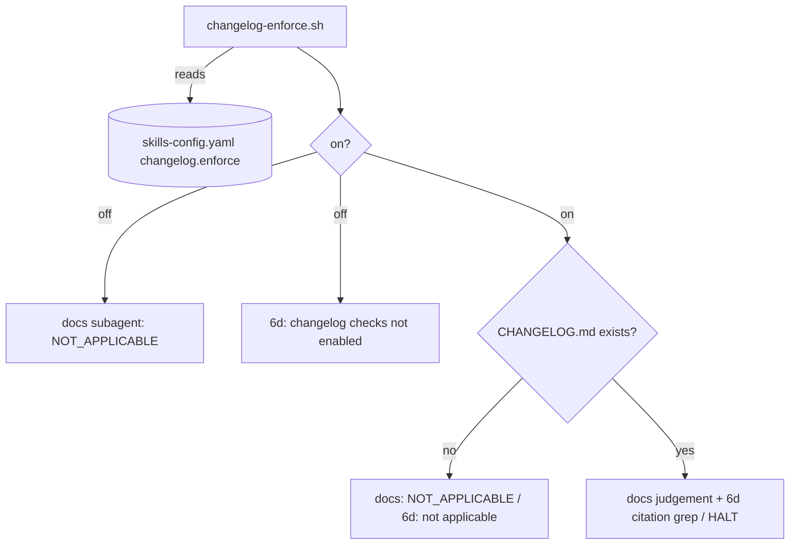

# Technical Task: Make /finalise changelog checks opt-in

**Status:** Ready for Review
**Review**: ✅ All review recommendations from `task.241.review.1.finalise-changelog-checks-opt-in.md` implemented 2026-10-28
**GitHub Issue**: [#772](https://github.com/Gamaroff/agent-skills/issues/772)

---

## 1. Overview

`/finalise` reads `CHANGELOG.md` in two places: the Step 4b docs subagent judges whether the change needed an entry, and Step 7 action 6d HALTs `no-changelog-entry` when `[Unreleased]` does not cite `(task N)`. Both enforce this repository's own release convention on every consumer. This task puts both behind one opt-in key, `changelog.enforce` in `skills-config.yaml`, off by default. When it is off, `/finalise` never opens `CHANGELOG.md`. This repository turns it on in its own config, so its behaviour does not change.

**Scope**: one shared resolver for the setting, the two `/finalise` call sites, this repo's `skills-config.yaml`, the configuration reference, the release and runbook docs that describe 6d, and the tests that run the 6d block.

**Key deliverables**:

1. `shared/resources/changelog-enforce.sh`: the one place that turns `changelog.enforce` into `on` or `off`.
2. 6d and the docs subagent both gated on it, with a `NOT_APPLICABLE` / skip line when off.
3. Behavioural tests: an unrelated `CHANGELOG.md` with the key unset is not read and does not HALT. Mutation-proved.

**Expected outcome**: a consumer repo with no `CHANGELOG.md`, or with one in its own format, sees no changelog warnings or halts from `/finalise`. This repo keeps the blocking 6d check and the docs judgement.

---

## 2. Motivation

### Current Problems

1. **Consumers get warnings for a convention they never adopted.** The docs subagent prompt (`shared/resources/finalise-dod-docs-prompt.md:23`, `### Step 2: Check CHANGELOG.md`) only says "If it exists, grep" and has no rule for an absent file. A user-facing change in a repo with no `CHANGELOG.md` is judged "Required", nothing is found, and the agent reports FAIL or NEEDS_MANUAL_REVIEW. Reported by the user on 2026-10-28.
2. **The two checks disagree.** Commit `605eb885` (2026-10-23, `git show -s 605eb885`) gave 6d a "no CHANGELOG.md, not applicable" skip after consumer repos halted. The docs subagent got no such skip (observation #118).
3. **Having the file is not the same as opting in.** 6d (`skills/finalise/SKILL.md`, `6d. **CHANGELOG citation check`) only accepts `task[ .]N` under `## [Unreleased]`. A consumer whose `CHANGELOG.md` is generated by release-please or semantic-release, or cites Jira keys or PR numbers, halts on every task. Its only way out is to delete its changelog.
4. **This repo's convention ships as a universal rule.** The `(task N)` citation convention is in `docs/contributing/releases.md` (the citation convention bullet) and exists because of obs #59 in this repository.

### Benefits

- `/finalise` never reads a consumer's changelog unless the project asks it to. No heuristics about whose changelog it is.
- One definition of "do changelog checks apply here?", read by both call sites, so they cannot disagree again.
- This repo keeps its at-acceptance block. That matters because `evals/shared/tests/changelog-entry-drift.test.mjs` only sees tasks whose merge is already in `HEAD`, so it catches a missing entry after the merge, not at acceptance (`docs/contributing/releases.md`, "The test" bullet).

---

## 3. Technical Background

### Current Architecture

- **Docs subagent**: `shared/resources/finalise-dod-docs-prompt.md`, Step 2 (`### Step 2: Check CHANGELOG.md`), returns a `CHANGELOG.md updated` check with PASS / FAIL / NOT_APPLICABLE. Dispatched from `skills/finalise/SKILL.md` (table row `| 4. Docs & changelog  | \`references/finalise-dod-docs-prompt.md\``) with `<STORY_FILE>`, `<PR_NUMBER>`, `<STORY_TYPE>`, `<DIFF_FILE>`. Its result feeds `DOCS_OVERALL` and the "Docs Updated?" column of the Step 6 decision matrix.
- **6d**: `skills/finalise/SKILL.md`, `6d. **CHANGELOG citation check (blocking — HALT \`no-changelog-entry\`).**`. Its bash block derives `N` from `STEM`, prints `6d: no CHANGELOG.md — not applicable` when the file is absent, and otherwise greps `[Unreleased]` for `task[ .]N`, exiting 1 with `HALT: no-changelog-entry …` on a miss.
- **Config reader**: `shared/resources/read-config.sh` provides `read_nested_config_key <parent> <child>` (header comment, `# Provides:`). It is already bundled at `skills/finalise/references/read-config.sh`. It reads `skills-config.yaml` from the cwd, or from `SKILLS_CONFIG_FILE` (`read-config.sh:58`, `SKILLS_CONFIG_FILE="${SKILLS_CONFIG_FILE:-skills-config.yaml}"`).
- **Tests**: `evals/shared/tests/finalise-publish-boundary.test.mjs` extracts the shipped 6d block (`function sixDBlock()`) and runs it under each shell in `SHELLS` in a temp directory (`function runSixD(shell, stem, changelog)`). It covers cited, missing, released-only, story stem and absent-file cases. The test `"/finalise 6d names \`no-changelog-entry\` as a HALT, and the release docs name the test"` asserts 6d's heading and `releases.md` text.
- **Reference idiom**: `/finalise` bash blocks source bundled helpers as `source .agents/skills/finalise/references/<file> || exit 1` (e.g. `newest-numbered.sh` in Step 0).

**Measured reader behaviour** (2026-10-28, `printf 'changelog:\n  enforce: %s\n' <v> > skills-config.yaml` then `AGENT_SKILLS_CONFIG_TIER=<tier> bash -c 'source shared/resources/read-config.sh && read_nested_config_key changelog enforce'`):

| Value | Tier `python` | Tier `awk` |
|---|---|---|
| `true` | `true` | `true` |
| `yes` | `true` | `yes` |
| `false` | `false` | `false` |
| key absent | empty | empty |

The tiers disagree on `yes`. A literal-`true`-only rule cannot remove that: under python `yes` already arrives as `true`, so `yes` would be on under python and off under awk. The resolver therefore takes the union. Every YAML 1.1 true spelling either tier can return (`true`, `yes`, `on`, any case) is on, every false spelling is off, and any other non-empty value is off with a warning on stderr. *(Corrected during implementation, 2026-10-28. The first draft said "literal `true` only", which this table contradicts.)*

**Existing mechanisms of the same kind**: none. `/finalise` has no other changelog gate, and no existing helper decides whether a check applies from config. The new resolver sits beside `read-config.sh` and calls it. It does not replace it.

### Target Architecture

```
skills-config.yaml            changelog:
                                enforce: true      # unset / false = off

shared/resources/changelog-enforce.sh
  sources read-config.sh (sibling)
  prints `on` or `off` on stdout; exit 0
  `true` -> on; empty or `false` -> off
  anything else -> off, plus one stderr line naming the value

/finalise Step 3 dispatch     CHANGELOG_ENFORCE=$(bash …/changelog-enforce.sh)
  docs subagent gets <CHANGELOG_ENFORCE>
    off -> CHANGELOG.md updated: NOT_APPLICABLE, "changelog checks not enabled"; never runs ls/grep on it
    on  -> today's Step 2, plus: absent file -> NOT_APPLICABLE, "repository keeps no CHANGELOG.md"

/finalise 6d                  calls changelog-enforce.sh in its own block
    off -> prints `6d: changelog checks not enabled`, exit 0, CHANGELOG.md never read
    on  -> today's block, unchanged
```



### Important Clarifications

- Each `/finalise` bash block may run in a fresh shell, so 6d calls the resolver itself rather than relying on a variable set at Step 3. Both sites call the same script, so the rule lives in one file.
- `changelog-entry-drift.test.mjs` is this repo's CI test and is not shipped to consumers. It is unchanged.

---

## 4. Scope

### In Scope

✅ New `shared/resources/changelog-enforce.sh` and its bundled copy in `skills/finalise/references/`.
✅ `/finalise` Step 3 dispatch: resolve once, substitute `<CHANGELOG_ENFORCE>` into the docs prompt.
✅ `shared/resources/finalise-dod-docs-prompt.md` Step 2: gate on `<CHANGELOG_ENFORCE>`, plus the absent-file `NOT_APPLICABLE` (observation #118's fix).
✅ `/finalise` 6d prose, bash block and completion-checklist line.
✅ This repo's `skills-config.yaml`: `changelog.enforce: true`.
✅ `docs/reference/configuration.md`: schema block and key-reference row.
✅ `docs/contributing/releases.md` (the "owner" bullet) and `docs/runbooks/task-development.md` (both `/finalise` changelog entries): say the checks run only when `changelog.enforce: true`.

**How the sweep list was found** (re-run it before Phase 3; a list without its search is recall): `git grep -n -l -E "no-changelog-entry|no CHANGELOG\.md|finalise-dod-docs-prompt|CHANGELOG\.md updated" -- ':!CHANGELOG.md' ':!docs/tasks' | grep -v /references/` (2026-10-28). It returned the in-scope files above plus `skills/create-pr/SKILL.md`, `skills/develop/SKILL.md`, the create-task/review-task templates and `sections-guide.md`, three historical DoD files under `docs/prd/`, and `tests/explore-prompts-no-write.test.js` (no-write only, unaffected). The rest are out of scope below.
✅ Tests: the resolver, the 6d block on and off, and the dispatch wiring.
✅ `CHANGELOG.md` `[Unreleased]` entry citing `(task 241)`, marked as a behaviour change for consumers.

### Out of Scope

❌ `skills/create-pr/SKILL.md` and `skills/develop/SKILL.md` checklist lines "CHANGELOG.md updated". They are reminders to the author, not checks, and read nothing.
❌ `skills/create-task` / `skills/review-task` task templates and `sections-guide.md` "CHANGELOG.md updated" example criteria. They are examples a consumer edits.
❌ Configurable citation patterns (Jira keys, PR numbers). Nobody has asked for one, and opt-in already removes the false halt.
❌ Story citations in 6d. Unchanged: tasks only, as today.
❌ `evals/shared/tests/changelog-entry-drift.test.mjs`. This repo only, unchanged.

---

## 5. Breaking Changes

### Consumers that keep a CHANGELOG.md lose the 6d block and the docs judgement by default

- **Before**: any repo with a `CHANGELOG.md` HALTed at 6d on an uncited task, and the docs subagent judged whether an entry was needed.
- **After**: with `changelog.enforce` unset, 6d prints `6d: changelog checks not enabled` and the docs subagent returns `NOT_APPLICABLE`.
- **Who is affected**: consumer repos that adopted the `(task N)` convention and want the block.
- **Migration path**: add to `skills-config.yaml`:

  ```yaml
  changelog:
    enforce: true
  ```

  The `CHANGELOG.md` entry for this task states this, and so does the configuration reference.

### A non-boolean value no longer reads as on

- **Before**: no key existed.
- **After**: `enforce: yes` reads as off with a warning, because the two reader tiers disagree on it (see § 3). Write `true`.

---

## 6. Implementation Plan

> Detailed implementation guide: [task.241.plan.finalise-changelog-checks-opt-in.md](task.241.plan.finalise-changelog-checks-opt-in.md)

### Phase 1: The resolver (Risk: Low)

**Files**: `shared/resources/changelog-enforce.sh`, `shared/resources/tests/changelog-enforce.test.mjs` (new)

- [x] Write `changelog-enforce.sh`: source sibling `read-config.sh`, read `changelog enforce`, print `on` / `off`, warn on stderr for any other value.
- [x] Test it under both tiers (`AGENT_SKILLS_CONFIG_TIER=python|awk`): absent file, absent key, `true`, `false`, `yes`, `on`. The test must SKIP loudly, not pass, when the python tier is unavailable.
- [x] Mutation-prove: make the script print `on` for an unrecognised value; the `enabled` and `1` cases go red under both tiers (4 red). *(Was "the `yes` case": `yes` is on by design after the § 3 correction.)*

**Dependencies**: none.

### Phase 2: Gate both call sites (Risk: Medium)

**Files**: `skills/finalise/SKILL.md`, `shared/resources/finalise-dod-docs-prompt.md`

- [x] 6d block: call the resolver first; when `off`, print `6d: changelog checks not enabled` and do nothing else. When `on`, run the existing block unchanged.
- [x] 6d prose: say the check runs only under `changelog.enforce: true`, and why (this repo's convention, opt-in).
- [x] Step 3 dispatch: resolve `CHANGELOG_ENFORCE` once before the four agents and add `<CHANGELOG_ENFORCE>` to row 4 of the substitution table.
- [x] Docs prompt Step 2: open with the `<CHANGELOG_ENFORCE>` gate (`off` -> `NOT_APPLICABLE`, note "changelog checks not enabled", no `ls`/`grep`), then the absent-file `NOT_APPLICABLE` when on. Add the placeholder to the frontmatter description and **Usage** line.
- [x] Completion checklist line for 6d: name the three outcomes (not enabled / no CHANGELOG.md / cited), otherwise HALT.

**Dependencies**: Phase 1.

### Phase 3: Config and docs (Risk: Low)

**Files**: `skills-config.yaml`, `docs/reference/configuration.md`, `docs/contributing/releases.md`, `docs/runbooks/task-development.md`, `CHANGELOG.md`

- [x] `skills-config.yaml`: add `changelog: enforce: true` with a comment pointing at the schema.
- [x] `configuration.md`: schema block entry and a `changelog.enforce` key-reference row (type boolean, default `false`; any YAML true spelling is on, per § 3).
- [x] `releases.md` "The owner" bullet and both runbook entries: state the opt-in.
- [x] `CHANGELOG.md` `[Unreleased]`: a Changed entry citing `(task 241)` with the migration line.

**Dependencies**: Phase 2.

### Phase 4: Tests, bundle and record (Risk: Medium)

**Files**: `evals/shared/tests/finalise-publish-boundary.test.mjs`, `skills/*/references/` (generated)

- [x] `runSixD` takes a config argument and lays out `.agents/skills/finalise/references/{changelog-enforce.sh,read-config.sh}` in its temp dir so the shipped block runs as written.
- [x] Existing 6d cases run with `enforce: true` and must still pass unchanged.
- [x] New cases: key unset with an uncited `CHANGELOG.md` -> exit 0, `6d: changelog checks not enabled`, no `HALT`. Same for `enforce: false`. An unrecognised value (`enforce: enabled`) -> off plus the warning. *(Was `enforce: yes`: on by design after the § 3 correction.)*
- [x] Control case (obs #176): an unset key with a `CHANGELOG.md` that **does** cite the task also prints the not-enabled line, which shows the gate fires before the grep and not because of what the grep found.
- [x] This repo's own `skills-config.yaml` resolves to `on` (guards § 10's "this repo silently loses 6d").
- [x] Wiring test: the dispatch table row 4 and the prompt both name `<CHANGELOG_ENFORCE>`, and the prompt's Step 2 opens with the gate.
- [x] Mutation-prove 6d: delete the gate line; the unset-key case goes red with `HALT: no-changelog-entry` (5 red). Dropping `<CHANGELOG_ENFORCE>` from row 4 turns the wiring test red (1 red).
- [x] Keep `6d: no CHANGELOG.md — not applicable` byte-identical: `finalise-publish-boundary.test.mjs` asserts it (the only test literal the change touches; `git grep -n -E "CHANGELOG citation checked|4\. Docs & changelog|Check CHANGELOG\.md|6d: no CHANGELOG|CHANGELOG\.md updated" -- '*.test.*' 'evals/**' 'tests/**'`).
- [x] Run the zsh arm locally and record the result in the implementation report — CI has no zsh lane. **Attempted, not runnable:** zsh is installed neither on this laptop nor on the `.249` server (checked 2026-10-28). The draft's "zsh is installed here" was wrong. The zsh arm is **unverified** for this change, which is a recorded residual. The new gate line uses only `[ "$CL" != on ]` and `echo`, constructs that behave the same in both shells.
- [x] `npm run bundle`, `npm run bundle:check`, `npm run generate-catalog`, `npm test`.

**Dependencies**: Phases 1–3.

---

## 7. Files Summary

### Files to Create

1. `shared/resources/changelog-enforce.sh`: resolves `changelog.enforce` to `on` / `off`.
2. `shared/resources/tests/changelog-enforce.test.mjs`: resolver tests, both tiers.

### Files to Modify (Core Implementation)

3. `skills/finalise/SKILL.md`: Step 3 dispatch, 6d prose and block, completion checklist.
4. `shared/resources/finalise-dod-docs-prompt.md`: Step 2 gate and absent-file rule.
5. `skills-config.yaml`: `changelog.enforce: true`.
5a. `shared/resources/read-config.sh`: `changelog|enforce` added to `_CONFIG_GUARDED_KEYS`, and the call-site comment updated. *(Found in implementation: `tracker-access.test.sh` § 44 pins the guarded list against every reader call site, and the new resolver is one.)*

### Files to Modify (Generated — `npm run bundle`)

6. `skills/finalise/references/changelog-enforce.sh` (new copy)
7. `skills/finalise/references/finalise-dod-docs-prompt.md`
7a. `skills/*/references/read-config.sh`: the 49 bundled copies of 5a.

### Files to Modify (Tests)

8. `evals/shared/tests/finalise-publish-boundary.test.mjs`: `runSixD` config argument, on/off cases, wiring test.

### Files to Modify (Documentation)

9. `docs/reference/configuration.md`
10. `docs/contributing/releases.md`
11. `docs/runbooks/task-development.md`
12. `CHANGELOG.md`

### Files to Delete

None.

---

## 8. Testing Strategy

### Unit Tests

- **Scope**: `changelog-enforce.sh` across both config tiers and every value in § 3's table, plus `on`.
- **Command**: `command node --test shared/resources/tests/changelog-enforce.test.mjs`
- **Target**: every row in § 3's table asserted under both tiers, with a loud skip when a tier is unavailable.

### Integration Tests

- **Scope**: the shipped 6d block, run as extracted from `SKILL.md`, under each shell in `SHELLS` (bash and zsh).
- **Cases**: on + cited (pass), on + uncited (HALT), on + released-only (HALT), on + story stem (pass), on + no file (not applicable), off/unset + uncited (not enabled, exit 0), off + cited (control: not enabled), `false`, `enabled` (off + warning).
- **Command**: `command node --test evals/shared/tests/finalise-publish-boundary.test.mjs`

### Performance Tests

Not applicable. One extra config read per `/finalise` run.

### Consumer Tests

- **Scope**: a consumer-shaped temp repo with no `skills-config.yaml`. The unset-key cases above are that consumer.
- **Risk areas**: the docs subagent's behaviour can't be run offline. The wiring test proves the value reaches the prompt. The prompt's instruction is checked by the first live `/finalise` run in a consumer repo, recorded in the implementation report.

---

## 9. Success Criteria

### Functional

- [x] With `changelog.enforce` unset, the shipped 6d block in a repo holding an uncited `CHANGELOG.md` exits 0 and prints `6d: changelog checks not enabled` — held per PR under bash by `finalise-publish-boundary.test.mjs`; the zsh arm runs where zsh is installed (CI's `ubuntu-latest` has none, so `SHELLS` drops it). **zsh arm unverified:** no host available to this run has zsh (Phase 4).
- [x] With `changelog.enforce: true`, every existing 6d case passes unchanged — the same file's existing cases, run with an `enforce: true` config fixture.
- [x] `changelog-enforce.sh` prints the same answer under both reader tiers: `on` for any YAML true spelling, `off` for unset or any false spelling, and `off` plus a stderr warning for any other non-empty value — held by `shared/resources/tests/changelog-enforce.test.mjs` (§ 3 correction).
- [x] The docs prompt's Step 2 instructs `NOT_APPLICABLE` ("changelog checks not enabled") when `<CHANGELOG_ENFORCE>` is `off`, and `NOT_APPLICABLE` ("repository keeps no CHANGELOG.md") when on and the file is absent; `/finalise` row 4 substitutes `<CHANGELOG_ENFORCE>` — a documentation criterion, held by the wiring test (the subagent itself cannot run offline).
- [x] This repo's own `skills-config.yaml` resolves to `on` — held by the this-repo assertion in `shared/resources/tests/changelog-enforce.test.mjs` (placed beside the resolver's other tests rather than in `finalise-publish-boundary.test.mjs`).

### Performance

- Not applicable: the change adds one config read per `/finalise` run and states no bound to hold.
- [x] The `/finalise` Step 3 dispatch still names four agents (documentation criterion: the dispatch table has four rows — held by a test in `finalise-publish-boundary.test.mjs`).

### Code Quality

- [x] Both gates mutation-proved: removing the 6d gate turns the unset-key cases red (5); making the resolver answer `on` for an unrecognised value turns the `enabled` / `1` cases red (4); dropping `<CHANGELOG_ENFORCE>` from row 4 turns the wiring test red (1).
- [x] `npm test`, `npm run bundle:check`, `npm run check:generated` and `npm run validate -- skills/finalise/` pass (`npm run ci:fast`: 6,567 tests, 0 failures; `eval:all` green).
- [x] shellcheck clean on `changelog-enforce.sh` at CI's `--severity=warning`.

### Migration

- [x] `configuration.md` documents `changelog.enforce` (schema block and key-reference row).
- [x] `CHANGELOG.md` `[Unreleased]` cites `(task 241)` and gives consumers the one-line opt-in.
- [x] `releases.md` and both runbook entries state the opt-in.

---

## 10. Risk Assessment

### High Risk Areas

None.

### Medium Risk Areas

1. **This repo silently loses 6d**
   - Risk: the `skills-config.yaml` key is mistyped or not read, and this repo's own changelog block turns off without anyone noticing.
   - Probability: Low. Impact: Medium. Missed entries come back, as in obs #59.
   - Mitigation: `changelog-entry-drift.test.mjs` still catches a missing citation after merge. Add one assertion that this repo's `skills-config.yaml` resolves to `on`.
   - Rollback: revert the commit.
2. **The 6d test layout diverges from a real install**
   - Risk: `runSixD` lays out the references so the block passes in the test but not at `.agents/skills/finalise/references/` in a consumer.
   - Probability: Low. Impact: Medium.
   - Mitigation: the test copies the bundled files from `skills/finalise/references/` to the exact path the block sources.
3. **Consumers relying on the block lose it**
   - Risk: covered in § 5.
   - Mitigation: the `CHANGELOG.md` entry and the configuration reference carry the one-line opt-in.
4. **The off-by-default gate widens what 6d lets through**
   - Risk: the gate is an exemption to a refuse-by-default check, so a mistake in it could pass an uncited task even when enforcement is on.
   - Probability: Low. Impact: Medium.
   - Mitigation (differential oracle): with `enforce: true`, the uncited (`task.303`) and released-only (`task.302`) cases must still HALT, exactly as they do on `develop` today. Phase 4 runs them unchanged under the config fixture, so any shape the base refuses and the head admits turns the test red.

### Low Risk Areas

1. **Docs subagent ignores the placeholder**: the prompt-following can't be tested offline. The first live consumer run confirms it, and is recorded in the implementation report.
2. **Bundled copy drift**: `bundle:check` in CI catches it.

---

## 11. Rollback Plan

### Immediate Rollback (< 1 hour)

- **Triggers**: this repo's `/finalise` stops halting on an uncited task, or any consumer `/finalise` run halts or errors in 6d.
- **Steps**: `git revert <merge commit>` on `develop`; `npm run bundle`; push.
- **Validation**: `command node --test evals/shared/tests/finalise-publish-boundary.test.mjs` passes on the reverted tree.

### Partial Rollback (1-2 hours)

- **When to use**: the resolver misbehaves on one tier.
- **Steps**: revert only Phase 2's 6d change, leaving the resolver, config and docs in place, and fix the resolver forward.

### Forward Fix

- **When to use**: wording or doc issues, or a docs-prompt instruction the subagent misreads.
- **Approach**: fix forward. Neither case blocks acceptance.

### Rollback Triggers

- **Critical**: 6d HALTs in a repo with the key unset; 6d passes an uncited task with `enforce: true`.
- **Non-critical**: warning text, doc wording.

---

## QA Testing Results

**QA Status**: CONCERNS
**QA Engineer**: QA Engineer
**Testing Date**: 2026-10-28
**Quality Score**: 70/100
**Gate Decision**: CONCERNS

### QA Report
- **Full Report**: [task.241.qa.1.finalise-changelog-checks-opt-in.md](./task.241.qa.1.finalise-changelog-checks-opt-in.md)
- **Gate File**: [task.241.gate.1.finalise-changelog-checks-opt-in.yml](./task.241.gate.1.finalise-changelog-checks-opt-in.yml)

### Test Coverage Summary
- **Tests Executed**: 6,567 (`npm run ci:fast`), 32 of them new; 15 security probes
- **Phases Verified**: 4/4
- **Critical Issues**: 0 high, 3 medium, 1 low
- **NFR Status**: Security: PASS, Performance: PASS, Reliability: CONCERNS, Maintainability: CONCERNS

### Key Findings
- **CR-1** (BUG-1): an unreadable config resolves to a silent `off`.
- **CR-2** (BUG-2): `finalise-dod-ac-prompt.md` and `finalise-dod-fix-evidence-prompt.md` still read
  `CHANGELOG.md` when the checks are off.
- **CR-3** (BUG-3): guarding the bare key `enforce` makes the awk reader refuse unrelated consumer
  configs. This is a regression against the base.
- **PROBE-1** (low): a block-scalar value gets a different answer from each tier.

## Change Log

<!-- change-log-start -->

| Date | Version | Description | Author |
| ---- | ------- | ----------- | ------ |
| 2026-10-28 | 1.0 | Initial draft — cut from observation #118 | create-task |
| 2026-10-28 | 1.1 | Review passed (8/10) — criteria re-scoped to what a per-PR test can hold (zsh arm local-only, docs prompt as a documentation criterion, performance bound marked not applicable), sweep search recorded, differential oracle named | review-task |
| 2026-10-28 |  | Status → ready-for-development | review-task |
| 2026-10-28 |  | Implemented — 11 source files + 51 bundled copies, 32 new tests; § 3 resolver rule corrected (YAML true spellings, not literal `true`); zsh arm unverified (no zsh host); Status → ready-for-review | develop |
| 2026-10-28 |  | QA gate CONCERNS (70/100) — 3 medium, 1 low findings | qa-task |
| 2026-10-28 |  | QA findings fixed — BUG-1 strict read + named warnings, BUG-2 agent 4 sole changelog owner + enumeration test, BUG-3 guard scoped to changelog.enforce, PROBE-1 block scalar named; 1 iteration | qa-fix |

<!-- change-log-end -->

## Progress Tracking

- [x] Phase 1: The resolver
- [x] Phase 2: Gate both call sites
- [x] Phase 3: Config and docs
- [x] Phase 4: Tests, bundle and record

### Implementation Summary (2026-10-28)

- **Approach:** implemented inline from the plan file by `/develop-task` Step 3. A new resolver, `changelog-enforce.sh`, is the single answer, and both `/finalise` sites read it: 6d prints `6d: changelog checks not enabled`, and the docs subagent gets `<CHANGELOG_ENFORCE>`.
- **Departures from the plan:**
  - The resolver accepts every YAML true spelling, because the python tier normalises `yes` to `true` (§ 3).
  - `read-config.sh`'s guarded-key list gained `changelog|enforce`, which `tracker-access.test.sh` § 44 required.
  - The this-repo assertion sits in the resolver's own test file.
- **Testing results:**
  - `npm run ci:fast`: 6,567 tests, 0 failures, 14 skipped.
  - `eval:all`, `bundle:check`, `check:generated` and `validate` all green.
  - 3 mutation proofs, each red, then green once restored.
- **Deferred / residual:** the zsh arm of the 6d tests is unverified, because neither the laptop nor `.249` has zsh.

QA artifacts will land beside this file: `task.241.qa.{N}.finalise-changelog-checks-opt-in.md`, bug reports as `task.241.bug.{N}.{name}.md`, gates as `task.241.gate.{N}.finalise-changelog-checks-opt-in.yml`.

## References

- Observation #118 — finalise docs subagent has no absent-CHANGELOG carve-out; 6d does
- Commit `605eb885`: 6d's no-CHANGELOG.md skip
- task.115 (PR #401): 6d and the drift test
- `docs/contributing/releases.md`: the `(task N)` citation convention
