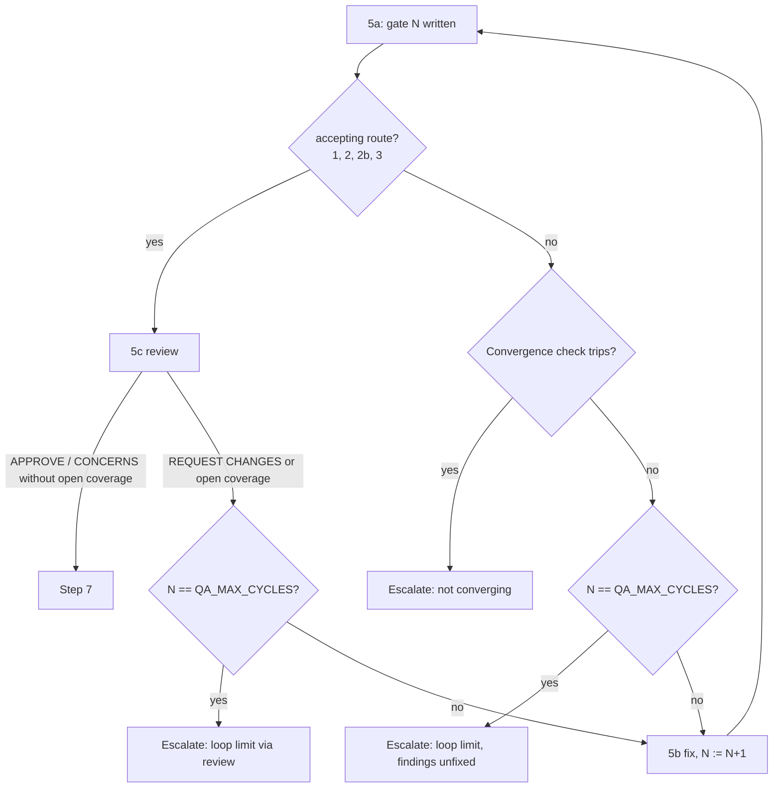

# Technical Task: The QA loop always ends on a gate

**Status:** Ready for Review
**Review**: ✅ All review recommendations from `task.244.review.1.qa-loop-ends-on-a-gate.md` implemented 2026-10-31
**GitHub Issue**: [#782](https://github.com/Gamaroff/agent-skills/issues/782)

---

## 1. Overview

**Description:** The QA loop's budget counts **gates**, not fix cycles. A fix (5b) runs only when a
gate will read it within the budget. The loop reads G1 → F1 → G2 → … → F(N-1) → GN: it always ends on
a gate, and a run never hands over fixed work that no QA has read.

**Scope:** The shared story/task QA loop (5a/5b/5c), its loop-limit escalation, the grant re-entry,
develop-bug's verify loop (the same gate → fix shape), and every document and test that restates the
budget or route 2c.

**Key Deliverables:**

- The budget check moves from after 5b to before it. At 5a or 5c of cycle `QA_MAX_CYCLES`, a gate or
  review that needs a fix escalates with its findings unfixed.
- Route 2c (the conditional "gate-the-last-fix" half-cycle) is deleted, because no budget ends on a
  fix any more.
- A grant re-enters from evidence: **5b** when nothing outside the work item moved since the newest
  gate's head, **5a** when something did (an ungated fix).

**Expected Outcome:** Every handover, clean or escalated, describes code a gate has read. The default
budget stays 5, which now means 5 gates and 4 fixes (user decision, 2026-10-29).

---

## 2. Motivation

### Current Problems

- **A spent budget always ends on an ungated fix.** §5b step 7 checks the budget **after** the fix:
  "If the counter reads `QA_MAX_CYCLES`, the budget is spent: do not return to 5a"
  (`shared/resources/develop-pipeline-step-5-6-qa-loop.md:1403`). Cycle N's fix lands, and no gate
  reads it.
- **Route 2c patches this only conditionally.** `classifyLoopRoute()` with `budgetSpent: true`
  (`shared/resources/qa-diminishing-returns.js:607`, *route 2c — gate the last fix*) grants the
  missing gate only when HIGH is 0 on the last gate and MEDIUM is falling or 0. Otherwise it returns
  `continue` and the run escalates an ungated fix. task.242 (2026-10-29) read MEDIUM 1, 1, 1, was
  declined with `medium-not-falling`, and handed over `cc0da45e` unread.
- **A grant only moves the gap.** A loop-limit grant re-enters at 5a
  (`shared/resources/grant-qa-cycles.sh:239`, `REENTER=5a`). It gates the old fix, then fixes again
  and ends on a new ungated fix. task.242 took two grants and ended ungated both times.
- **The condition keeps being loosened by hand.** Route 2c's predicate was widened after obs #139
  (task.130, task.125) and obs #300 (task.173, task.143). Each time, a declined loop was granted a
  cycle by hand and read clean. Whether a fix gets reviewed should not depend on predicting that the
  review will pass.
- **The same shape in develop-bug.** Its verify loop's 5b ends "Increment the counter and return to
  **5a**" (`skills/develop-bug/references/develop-bug-step-5-6-verify-loop.md`, 5b step 5), and its
  Loop Limit Escalation fires "after 5 cycles without PASS". The order of the limit test and the fifth
  fix is not stated, so a fifth fix may be unverified. This document states it.

### Benefits

- **Every handover is gated.** An escalation hands over findings a gate wrote about the code being
  handed over. It never hands over a fix nobody has read.
- **One rule, not a predicate.** The budget check sits in one place. Route 2c, its five decline
  reasons and its three loosenings go away.
- **A grant buys exactly what it says.** After a new-shape halt, "k more cycles" means k fixes, each
  followed by its gate.
- **Fewer hand grants.** A fix that would read clean can no longer be stranded by the budget, which is
  what task.117/125/130/143/173 needed a human for.

---

## 3. Technical Background

### Current Architecture

- **Loop Setup** (`develop-pipeline-step-5-6-qa-loop.md` § Loop Setup): the limit is
  "`QA_MAX_CYCLES` complete cycles", read as `jq -r '.qa_max_cycles // 5'`. A cycle is 5a (gate) plus
  5b (fix).
- **§5b step 7** (`:1403`, `**If the counter reads QA_MAX_CYCLES, the budget is spent**`): after the
  fix commits, a spent budget goes to Loop Escalation; otherwise the counter is incremented and the run
  returns to 5a.
- **§5c Verdict branching** (`:1547`, `🚨 **REQUEST CHANGES**`): returns to 5b, and "5b's step 7
  increments it on exit". A REQUEST CHANGES on the last cycle therefore also ends on an ungated fix.
- **Route 2c**:
  - Its home is § *Gate-the-last-fix half-cycle* (`:1896`), the Loop limit trigger row (`:1893`), and
    §5c route 5 (`:1438`, `5. **(route 2c)**`).
  - The engine pieces are `ROUTES.GATE_THE_LAST_FIX` (`qa-diminishing-returns.js:482`),
    `RUNNING_QA_FIX_RE` (`:490`) and the `budgetSpent` branch (`:607`). Its decline reasons are
    `last-cycle-not-a-fix`, `below-cycle-floor`, `high-counts-missing`, `high-on-last-gate`,
    `gate-unreadable`, `medium-counts-missing` and `medium-not-falling`.
  - A cycle it writes carries a `**Half-cycle**: gate-the-last-fix` row (`:489`).
- **Grant** (`grant-qa-cycles.sh`):
  - The base is the highest gate number, read through the sibling `qa-cycle.sh`.
  - It writes `qa_max_cycles = base + k`, `convergence_from_cycle = base + 1`, and `qa_phase` set from
    the halt reason (`:239-246`): `not-converging*` → 5b, otherwise 5a.
- **Code movement since a gate** is computed once today, as an inline bash block in qa-task Phase 0
  (`skills/qa-task/SKILL.md`, the `CODE_MOVED=$(git rev-list --count "$GATE_HEAD"..HEAD -- .
  ":(exclude)$TASK_DIR" …)` block). It counts commits, uncommitted edits and untracked files outside
  the task directory since the gate's `head:`. `shared/resources/tests/qa-scope-from-head.test.mjs`
  executes it (`CODE_MOVED=$CODE_MOVED` at `:320`). qa-story has no `CODE_MOVED` (grep: 0 hits in
  `skills/qa-story/SKILL.md`).

### Target Architecture

The decision flow at 5a and 5c:

- **The one rule:** 5b runs only when `N < QA_MAX_CYCLES`. The test sits in the two places that route
  to 5b: Outcome branching (after the Convergence check and routes 2/2b) and §5c's REQUEST CHANGES
  arm. §5b step 7 loses its budget test and always increments and returns to 5a.
- **Route 2c is removed.** No branch of `classifyLoopRoute()` takes `budgetSpent`. The
  `**Half-cycle**` row is no longer written, but readers (resume contract, report-lint) still accept it
  in existing reports.
- **Escalation commits the last gate.** A loop-limit escalation now happens at 5a or 5c, not after a
  5b. Its escalation commit carries gate N and QA report N, as a convergence stall's already does.
- **Grant re-entry from evidence.** A new sibling helper, `shared/resources/code-moved-since-gate.sh`,
  holds the qa-task Phase 0 computation. It takes the work-item directory and a gate path and prints
  the count. qa-task Phase 0 and `grant-qa-cycles.sh` both call it, so the computation exists once.
  The grant writes `qa_phase=5a` when the count is above 0 (an ungated fix, e.g. a pre-change halt)
  and `5b` otherwise. This replaces the halt-reason match. Witness on this branch: since task.242's
  gate 7 head the count is 1 (`cc0da45e`); since `cc0da45e` it is 0, because the escalation commit
  touched only the task directory and `.claude/` is gitignored (`.gitignore:19`).
- **develop-bug** gets the same rule: 5b runs only when a verify cycle will follow within
  `MAX_ITER`.

### Important Clarifications

- **The counter's meaning changes, its field does not.** `qa_max_cycles` keeps its name and now
  counts gates. Gate N is cycle N. The fix after gate N belongs to cycle N, and it exists only when
  N < max.
- **Convergence check, route 2 and route 2b are unchanged.** They already decide at 5a, before 5b.
- **This is not a free extra gate.** At the default of 5, the run gets one fewer fix than today, by
  the user's choice. A loop that needs a fifth fix escalates with gate 5's findings unfixed.

---

## 4. Scope

### In Scope

- ✅ The 5a/5c budget test and the §5b step 7 change in `develop-pipeline-step-5-6-qa-loop.md`.
- ✅ Deleting route 2c from the engine, the step doc, §5c's route set, and the tests and evals built
  on it.
- ✅ `code-moved-since-gate.sh`, plus its use by qa-task Phase 0 and by `grant-qa-cycles.sh`.
- ✅ develop-bug's verify loop: the same rule, stated.
- ✅ The doc sweep: every site that restates the budget, route 2c or the grant's re-entry phase.
- ✅ The CHANGELOG entry saying the budget now counts gates.

### Out of Scope

- ❌ Changing the default number (5). The user decided it stays 5.
- ❌ The Convergence check, routes 2/2b, the third-strike rule and the narrowing offer. They are
  untouched.
- ❌ Rewriting existing implementation reports that carry a `**Half-cycle**` row. They stay valid
  history.
- ❌ task.242's current halt. It is resumed under today's rules (§ Notes).

---

## 5. Breaking Changes

### A budget of N now gives N gates and N−1 fixes

- **Before → after:** `qa_max_cycles: 5` used to run 5 gates and 5 fixes, with the 5th fix ungated
  unless route 2c fired. It now runs 5 gates and at most 4 fixes.
- **Before:** gate 5 CONCERNS → fix 5 → route 2c declines → escalate an ungated head.
- **After:** gate 5 CONCERNS → escalate with gate 5's findings open and unfixed, on a head gate 5 read.
- **Affected:** develop-story, develop-task and develop-bug runs that reach the limit; operators who
  read "k more cycles" as k fixes; eval scenarios `11-qa-budget-spent-gate-the-last-fix-half-cycle`
  (develop-story and develop-task).
- **Migration path:**
  1. A halt written before this change has an ungated fix. The grant sees code moved since the newest
     gate's head and re-enters at 5a, which gates that fix first. No operator action is needed.
  2. A halt written after this change re-enters at 5b and fixes the open findings.
  3. A consumer that pinned `qa_max_cycles` to buy a set number of fixes adds 1 to keep the same
     number of fixes.
  4. The CHANGELOG entry says this in one line.

### Route 2c and `budgetSpent` are removed from `classifyLoopRoute()`

- **Before → after:** `classifyLoopRoute({…, budgetSpent: true, lastCycleAction})` used to return
  `gate-the-last-fix` or a decline. The parameters are removed, and `ROUTES.GATE_THE_LAST_FIX` no
  longer exists.
- **Affected:** the step doc's half-cycle block (the only production caller), `qa-loop-route.test.mjs`
  and `describeLoopRoute()`.
- **Migration path:** the caller's block is deleted in the same change. The engine **ignores**
  `budgetSpent`; it does not throw, so a stale bundled copy in a consumer keeps routing mid-loop.
  `describeLoopRoute()` keeps a branch for the old route token, reading "route 2c (removed in task.244)",
  so an old `ROUTE_JSON` in a report still renders.

---

## 6. Implementation Plan

> Detailed implementation guide: [task.244.plan.qa-loop-ends-on-a-gate.md](task.244.plan.qa-loop-ends-on-a-gate.md)

### Phase 1: The rule in the step doc (Risk: High)

**Files:** `shared/resources/develop-pipeline-step-5-6-qa-loop.md`

- [ ] Loop Setup: the limit is `QA_MAX_CYCLES` **gates**. State the one rule ("5b runs only when a gate
      will follow it within the budget") once, and point every other site at it.
- [ ] Outcome branching: after the Convergence check and routes 2/2b resolve to 5b, test
      `N == QA_MAX_CYCLES` → Loop Escalation (*Loop limit*), with Action `Escalating — loop limit
      reached` and PR Review `not reached — gate did not exit the loop`.
- [ ] §5c REQUEST CHANGES / open-coverage arm: on `N == QA_MAX_CYCLES`, escalate (*Loop limit via
      review*) instead of entering 5b.
- [ ] §5b step 7: drop the budget test; always increment and return to 5a.
- [ ] Loop Escalation: the trigger table, the "cycles that actually ran" sentence, and both escalation
      commits (now carrying gate N and QA report N). Delete § *Gate-the-last-fix half-cycle*, the
      `**Half-cycle**` template row, §5c route 5 and the guard table's budget row.
- [ ] The HALT message's option 4 and the shared-budget paragraph (`:1781`, `:1993`).

### Phase 2: Engine and grant (Risk: Medium)

**Files:** `shared/resources/qa-diminishing-returns.js`, `shared/resources/grant-qa-cycles.sh`,
`shared/resources/code-moved-since-gate.sh` (new), `skills/qa-task/SKILL.md`

- [ ] Delete the `budgetSpent` branch, `ROUTES.GATE_THE_LAST_FIX` and `RUNNING_QA_FIX_RE`. Keep the
      `describeLoopRoute()` legacy token branch.
- [ ] Extract the qa-task Phase 0 `CODE_MOVED` computation into `code-moved-since-gate.sh`, with a
      `bundle-dependency:` comment like `qa-cycle.sh`'s. qa-task Phase 0 calls it.
- [ ] `grant-qa-cycles.sh`: re-entry from the helper's count (> 0 → 5a, 0 → 5b), replacing the
      `HALT_REASON` case. A helper that cannot answer fails toward 5a, which re-gates, never toward a
      fix on unread code.

### Phase 3: develop-bug (Risk: Medium)

**Files:** `skills/develop-bug/references/develop-bug-step-5-6-verify-loop.md`

- [ ] At the end of 5a, when the verify fails and `N == MAX_ITER`, go to Loop Limit Escalation instead
      of 5b. 5b step 5 always increments and returns to 5a. The escalation heading says "after
      `MAX_ITER` verify cycles".

### Phase 4: Sweep, tests, evals, bundle (Risk: Medium)

- [ ] Sweep the population in § 7 *Documentation*. Each site is either updated or recorded as
      unaffected.
- [ ] Tests and evals per § 8. Run `npm run bundle`, then `npm run generate-catalog` (SKILL.md
      descriptions change).
- [ ] Add the CHANGELOG entry.

---

## 7. Files Summary

**Population command** (re-run it; do not trust a count written here):
`git grep -ln "gate-the-last-fix\|Gate-the-last-fix\|half-cycle\|Half-cycle\|GATE_THE_LAST_FIX\|budgetSpent" -- ':!docs/tasks' ':!docs/bugs' ':!**/references/**' ':!CHANGELOG.md' ':!docs/prd'`,
plus `git grep -n "5-cycle\|up to 5 cycles" -- 'skills/*/SKILL.md' 'shared/resources/*.md' docs/operations/workflows.md`.
Every hit is in scope or is a stated exclusion below.

### Files to Create

1. ✅ `shared/resources/code-moved-since-gate.sh`: the code-movement count, extracted from qa-task Phase 0.

### Files to Modify (Core Implementation)

2. ✅ `shared/resources/develop-pipeline-step-5-6-qa-loop.md`: Phase 1.
3. ✅ `shared/resources/qa-diminishing-returns.js`: Phase 2.
4. ✅ `shared/resources/grant-qa-cycles.sh`: Phase 2.
5. ✅ `skills/qa-task/SKILL.md`: Phase 0 calls the helper.
6. ✅ `skills/develop-bug/references/develop-bug-step-5-6-verify-loop.md`: Phase 3.

### Files to Modify (Tests and Evals)

7. ✅ `shared/resources/tests/qa-loop-route.test.mjs`: remove the route-2c rows; add the budget-blind rows.
8. ✅ `shared/resources/tests/fixtures/qa-diminishing-returns/medium-falling-cycle5.yml`: repurpose it
   as task.242's inputs for the budget-blind row if the route-2c rows were its only readers; remove it
   only when `git grep medium-falling-cycle5` shows no reader left (decided in Phase 4).
9. ✅ `shared/resources/grant-qa-cycles.test.sh`: re-entry-from-evidence cases.
10. ✅ `shared/resources/tests/qa-scope-from-head.test.mjs`: still green through the helper.
11. ✅ `evals/shared/tests/pr-review-loop-parity.test.mjs`: route 5 assertion (`:248`) and the Action-row
    value set (`:535`).
12. ✅ `evals/shared/tests/qa-loop-lock-fields-parity.test.mjs`: the half-cycle section anchor (`:641`).
13. ✅ `evals/shared/tests/qa-escalation-template.test.mjs`: escalation and grant wording.
14. ✅ `evals/develop-{story,task}/step-isolation/11-qa-budget-spent-gate-the-last-fix-half-cycle/`:
    rewritten as "budget spent at 5a → escalate, no fix" (renamed directory, both pipelines).
15. ✅ New `evals/shared/tests/qa-loop-ends-on-a-gate.test.mjs`: the doc never routes to 5b at
    `N == QA_MAX_CYCLES` (§ 8).

### Files to Modify (Documentation)

16. ✅ `shared/resources/develop-pipeline-resume-contract.md` (`:676` and the re-entry section).
17. ✅ `shared/resources/pr-conformance-prompt.md` (`:67`).
18. ✅ `skills/develop-task/SKILL.md`, `skills/develop-story/SKILL.md` (the `reenter_at` line, `:340` and
    `:353`; the shared-budget line, `:239` and `:252`; the descriptions) and their `README.md`s.
19. ✅ `skills/develop-bug/SKILL.md` (description and the MAX_ITER table row).
20. ✅ `skills/review-pr/SKILL.md:1077` (updated). `shared/resources/code-review-prompt.md:219` checked, "up to 5 cycles" wording still true, left unchanged.
21. ✅ `docs/runbooks/qa-flow.md` (diagram and table), `docs/reference/troubleshooting.md:201`,
    `docs/operations/workflows.md` checked, wording still true, left unchanged.
22. ✅ `CHANGELOG.md`.

**Stated exclusions:** `.agents/plans/doc-drift-audit-2026-10-07.md` (a dated audit record),
`shared/resources/tests/fixtures/report-lint/green/task.123.md` and `task.118.md` (real historical
reports; they must stay lint-green, which is the backward-compatibility check), and every
`references/` copy (regenerated by `npm run bundle`).

---

## 8. Testing Strategy

### Unit Tests

- `qa-loop-route.test.mjs`:
  - Remove the route-2c rows.
  - Add a row passing `budgetSpent: true` with task.242's inputs (HIGH `2,3,1,0,0,0,0`, MEDIUM
    `3,0,0,1,1,1`, gate 7). The route equals the `budgetSpent: false` result: the flag is ignored.
  - Add a row asserting `describeLoopRoute({ route: "gate-the-last-fix", … })` renders the legacy text.
- `grant-qa-cycles.test.sh`:
  - (a) Gate N at HEAD, no movement → `reenter_at=5b`.
  - (b) A commit outside the work-item dir after gate N's head → `reenter_at=5a`.
  - (c) An uncommitted edit outside the dir → 5a.
  - (d) The helper is missing or not runnable → 5a, with a warning.
  - (e) A `not-converging` halt with no movement → 5b (today's behaviour, now from evidence).
- `qa-scope-from-head.test.mjs`: unchanged assertions, green through the helper.
- Command: `command node --test shared/resources/tests/qa-loop-route.test.mjs shared/resources/tests/qa-diminishing-returns.test.mjs shared/resources/tests/qa-scope-from-head.test.mjs && bash shared/resources/grant-qa-cycles.test.sh`.

### Integration Tests

- `qa-loop-ends-on-a-gate.test.mjs` reads the step doc and asserts four things:
  - Each arm that routes to 5b (Outcome branching and §5c REQUEST CHANGES) carries the
    `QA_MAX_CYCLES` test and its escalation, keyed on the rule's single sentence.
  - §5b step 7 has no budget test.
  - No `Gate-the-last-fix` section remains.
  - develop-bug's verify loop carries the `MAX_ITER` test before 5b.
  - **Control:** the test is mutation-proven against the old step-7 placement restored in a copy of
    the doc. It must go red. A restatement that says "fix, then check the budget" in other words is
    caught by the §5b step 7 assertion, not by a keyword.
- The rewritten step-isolation evals:
  - Replay a cycle-5 CONCERNS gate with budget 5. The expected outcome is an escalation with no
    `fix(` commit, and gate 5 in the escalation commit.
  - A second scenario: a 5c REQUEST CHANGES at cycle 5 escalates as *loop limit via review*.

### Performance Tests

Not applicable. The change removes work. At the default budget, an escalating run costs one fewer
fix, and nothing is added.

### Consumer Tests

- `npm run ci:fast`, `npm run bundle:check`.
- `npm run eval:all` (hermetic layers), for the rewritten step-isolation scenarios.
- Replay task.242 (see § 9): today's engine returns `continue (medium-not-falling)`; under the new
  rule, cycle 7 is a gate that escalates with QA7-1 unfixed.

---

## 9. Success Criteria

### Functional

- [ ] SC-1: the step doc routes to 5b only when `N < QA_MAX_CYCLES`, in both places that route there
      (Phase 1). At `N == QA_MAX_CYCLES` both escalate with the gate's or review's findings unfixed.
- [ ] SC-2: §5b step 7 always increments and returns to 5a. No budget test remains after a fix
      (Phase 1).
- [ ] SC-3: route 2c is gone. Phase 2 deletes its engine branch: `classifyLoopRoute()` returns the
      same route for `budgetSpent: true` and `false` on identical inputs. The step doc has no
      half-cycle section and no §5c route 5 (Phase 1).
- [ ] SC-4: `grant-qa-cycles.sh` writes `qa_phase=5b` when `code-moved-since-gate.sh` reports 0 and
      `5a` when it reports more than 0 or cannot answer (Phase 2). Test cases (a)–(e) pass.
- [ ] SC-5: develop-bug's verify loop escalates at `N == MAX_ITER` on a failed verify, with no fifth
      fix (Phase 3).
- [ ] SC-6: an escalation commit at 5a carries gate N and QA report N (Phase 1).

### Performance

- [ ] SC-7: at the default budget an escalating run runs no more cycles than today: 5 gates, at most
      4 fixes. Held by the rewritten step-isolation scenario 11 (§ 8: a cycle-5 CONCERNS gate with
      budget 5 escalates with no `fix(` commit) and by `qa-loop-ends-on-a-gate.test.mjs`, which pins
      the `N < QA_MAX_CYCLES` test on both arms that route to 5b.

### Code Quality

- [ ] SC-8: `npm run ci:fast` and `npm run bundle:check` are green. `npm run validate -- skills/develop-task/ skills/develop-story/ skills/develop-bug/ skills/qa-task/`
      passes. The new integration test is mutation-proven (restore the old step-7 placement → red).
- [ ] SC-9: the code-movement computation exists once. qa-task Phase 0 and the grant both call
      `code-moved-since-gate.sh`, and neither carries its own `git rev-list` count.

### Migration

- [ ] SC-10: the existing reports that carry `**Half-cycle**` rows (task.166, task.207) and the
      fixtures in `shared/resources/tests/fixtures/report-lint/green/` stay lint-green. The CHANGELOG states that the budget now counts gates,
      and how to keep a fix count.

---

## 10. Risk Assessment

### High Risk Areas

1. **A doc site keeps the old order.**
   - **Risk:** any restatement of "fix, then check the budget" sends a run back to an ungated handover.
   - **Probability:** Medium. The rule is restated in at least 10 files (§ 7).
   - **Impact:** High.
   - **Mitigation:** run the population command and record each hit as updated or unaffected. The
     integration test checks the step-7 sentence, not a keyword. Memory note: behaviour changes need a
     doc sweep.
   - **Rollback:** revert the PR.

### Medium Risk Areas

1. **The grant mis-reads movement.**
   - **Risk:** a gate whose `head:` is not a commit on this branch reads as moved, so the grant
     re-enters at 5a and spends one gate re-reading code.
   - **Mitigation:** this is the safe direction by design (the qa-task Phase 0 rule). Test (d) pins it.
2. **The eval rewrite drops coverage.**
   - **Risk:** the step-isolation scenario 11 is the only end-to-end test of the budget.
   - **Mitigation:** rewrite it rather than delete it. Add the 5c-at-budget scenario.
3. **One fewer fix at default.**
   - **Risk:** runs that used to succeed on a fifth fix now escalate.
   - **Mitigation:** this was the user's decision. The CHANGELOG says how to raise `qa_max_cycles`.

### Low Risk Areas

1. **Old reports with a `**Half-cycle**` row.** Readers keep accepting it, and SC-10 holds it.
2. **Stale bundled engines in consumers.** The engine ignores `budgetSpent`, so a stale copy still
   works.

---

## 11. Rollback Plan

### Immediate Rollback (< 1 hour)

**Triggers:** a run routes to 5b at `N == QA_MAX_CYCLES`; a grant re-enters at 5b over an ungated fix;
`ci:fast` or `eval:all` is red on develop after merge.

**Steps:**
1. `git revert` the merge commit on develop.
2. `npm run bundle && npm run bundle:check`.
3. Push.

**Validation:** `qa-loop-route.test.mjs` route-2c rows are back and green.

### Partial Rollback (1-2 hours)

**When to use:** the step-doc rule is sound but the grant's evidence check misbehaves.

**Steps:**
1. Revert only `grant-qa-cycles.sh` to the halt-reason match, with `loop-limit` mapped to 5b, which
   the new halt shape needs.
2. Keep the helper and the step doc.

### Forward Fix

**When to use:** a missed doc site or an eval wording drift.

**Approach:** fix it in place on develop, with a test that reproduces it first.

### Rollback Triggers

**Critical (Immediate Rollback):** any handover of an ungated fix produced by the new rule.

**Non-Critical (Forward Fix):** doc wording, an eval label, a CHANGELOG phrasing.

---

## QA Testing Results

**QA Status**: PASS
**QA Engineer**: QA Engineer
**Testing Date**: 2026-10-30
**Quality Score**: 100/100
**Gate Decision**: PASS

### QA Report
- **Full Report**: [task.244.qa.2.qa-loop-ends-on-a-gate.md](./task.244.qa.2.qa-loop-ends-on-a-gate.md)
- **Gate File**: [task.244.gate.2.qa-loop-ends-on-a-gate.yml](./task.244.gate.2.qa-loop-ends-on-a-gate.yml)

### Test Coverage Summary
- **Tests Executed**: `npm test` 6894 pass / 0 fail, `eval:all` green; 9 security probes on the helper (0 escaped)
- **Phases Verified**: 4/4
- **Critical Issues**: 0
- **NFR Status**: Security: PASS, Performance: PASS, Reliability: PASS, Maintainability: PASS

### Key Findings
Cycle 1's blocker (T244-QA-1, the first-review HALT in qa-task Phase 0) is fixed and held by a test that goes red without the fix. The refute pass over the whole branch found no new defect. Two advisory test-coverage notes are recorded as future work in the gate.

<!-- change-log-start -->
## Change Log

| Date       | Version | Description   | Author      |
| ---------- | ------- | ------------- | ----------- |
| 2026-10-29 | 1.0     | Initial draft. Prompted by task.242, whose loop-limit halt handed over `cc0da45e` unread after route 2c declined (`medium-not-falling`) | create-task |
| 2026-10-29 |         | Renumbered task.243 → task.244 before first commit: `feature/task.243.wireframe-component-mapping` had already claimed 243 | operator |
| 2026-10-31 | 1.1     | Review passed (9/10): SC-7 now names the tests that hold it; `:317` anchor → `:320`; fixture 8 decision criterion stated | review-task |
| 2026-10-31 |         | Status → ready-for-development | review-task |
| 2026-10-31 |         | Implemented — 86 files, 7 new tests, 4 evals; npm test + bundle:check green | develop |
| 2026-10-31 |         | QA gate FAIL (70/100) — 1 high, 2 low findings | qa-task |
| 2026-10-31 |         | QA findings fixed — gate FAIL (70/100) cycle 1, 1 iteration: empty-gate first-review guard in code-moved-since-gate.sh, grant comment, SC-10 wording | qa-fix |
| 2026-10-31 |         | QA gate PASS (100/100) — 0 findings | qa-task |
<!-- change-log-end -->

---

## Progress Tracking

- [x] Phase 1: The rule in the step doc
- [x] Phase 2: Engine and grant
- [x] Phase 3: develop-bug
- [x] Phase 4: Sweep, tests, evals, bundle

---

## References

- task.242 implementation report: the escalation entries for cycles 6 and 7 (route 2c declined,
  `medium-not-falling`).
- obs #112 (route 2c's origin, task.117), obs #139 (task.130/125 loosening), obs #300 (task.173/143
  loosening).
- `shared/resources/develop-pipeline-step-5-6-qa-loop.md` § 5b step 7, § Gate-the-last-fix half-cycle,
  § 5c Verdict branching.
- `shared/resources/grant-qa-cycles.sh` (re-entry phase), `skills/qa-task/SKILL.md` Phase 0 (the
  `CODE_MOVED` block).

## Notes

- **task.242 is resumed under today's rules.** Its halt has an ungated fix (`cc0da45e`). A
  "Resume the QA loop with 1 more cycle" grant re-enters at 5a under the current script and gates it.
  That gate is the run's last, whatever it finds.
- QA artifacts will land beside this document: `task.244.qa.{N}.qa-loop-ends-on-a-gate.md`,
  `task.244.gate.{N}.qa-loop-ends-on-a-gate.yml`, and `task.244.bug.{N}.*.md` for any bugs.
