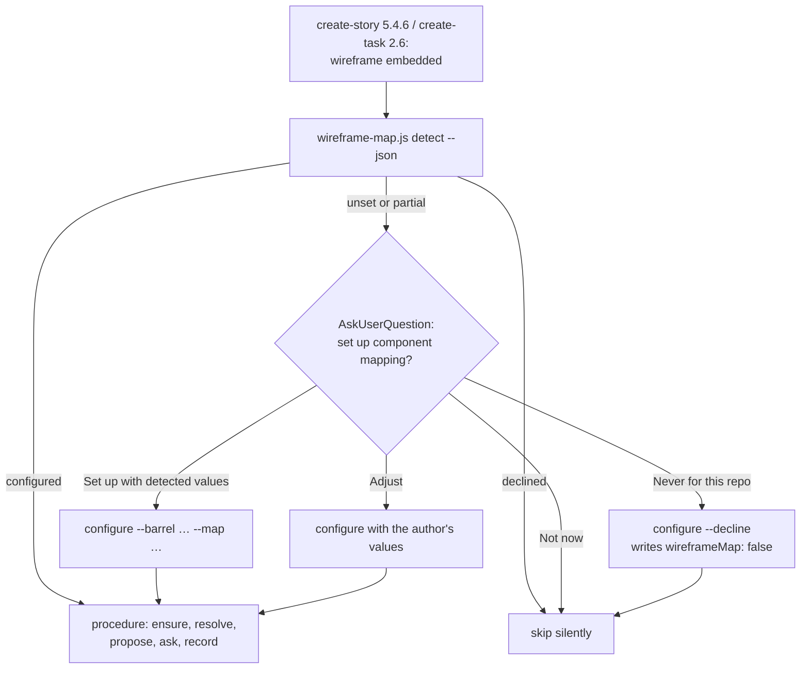

# Wireframe mapping setup offer and first-run candidates

**Status:** Ready for Review
**Review**: ✅ All review recommendations from `task.246.review.1.wireframe-mapping-setup-offer.md` implemented 2026-10-29
**GitHub Issue**: [#792](https://github.com/Gamaroff/agent-skills/issues/792)

---

## 1. Overview

Task 243 shipped wireframe → component mapping as an opt-in feature: a project that writes a `ui:`
block into `skills-config.yaml` gets every Wireloom node resolved to one of its components. This
task makes the feature find its users and makes its first run useful. When `create-story` or
`create-task` adds a wireframe and the project has no `ui:` block, the skill detects the project's
components, asks once whether to set mapping up, and writes the block (or a remembered "never")
through the engine. `resolve` then offers candidates drawn from the catalogue when the map has none,
and the map's hand-written rows get a guide.

**Scope**: three parts, one task. (a) the setup offer in the two authoring skills, backed by two
new engine commands, `detect` and `configure`, and a `declined` state; (b) catalogue-derived
candidates in `resolve`; (c) a "Writing map rows by hand" guide in the procedure, the configuration
reference and the seeded map header, documenting the sibling-context and icon-glyph limits.

**Key deliverables**

1. `wireframe-map.js detect` (read-only) and `configure` (writes the `ui:` block or a decline, or
   completes a `partial` block that lacks `wireframeMap`), and `reason: declined` from every command
   when `ui.wireframeMap` is `false` or `off`.
2. `create-story` 5.4.6 and `create-task` 2.6 offer setup when the engine reports `unset`, and stay
   silent when it reports `declined`.
3. `resolve` returns catalogue-derived candidates, marked `source: catalogue`, for an open node no
   map row nearly matches.
4. A "Writing map rows by hand" section with worked example rows and the two documented limits.

**Expected outcome**: a consumer who has never heard of the `ui:` block is offered mapping the first
time it would help, answers one question, and the first story after setup is proposed components
from the catalogue rather than from the agent's reasoning alone.

---

## 2. Motivation

### Current Problems

1. **The feature is invisible.** Without a `ui:` block every skill skips the mapping step and says
   nothing (procedure `wireframe-component-mapping.md:7`, *Off unless configured*; `create-story`
   5.4.6 step 3 at `skills/create-story/SKILL.md:762` and `create-task` 2.6 step 3 at
   `skills/create-task/SKILL.md:511`: "otherwise skip silently"). A consumer learns about it only
   from release notes.
2. **The one manual step needs knowledge the consumer does not have.** Five keys and two file paths
   (`docs/reference/configuration.md:236`, the `ui:` example). The `rebirth-wallet` confirmation of
   v0.62.0 (2026-10-29) needed an agent that had read the handoff to write it.
3. **A first run proposes nothing.** `resolve`'s candidates come only from map rows that nearly
   matched (`nearMisses`, `shared/resources/wireframe-map.js:458`). On an empty map every open node
   has `candidates: []`; the confirmation saw this on all 37 nodes of its first story.
4. **There is no way to say "never".** `readUiConfig` (`wireframe-map.js:107`) reads
   `wireframeMap: false` as unset (its `str()` helper returns `null` for a non-string) and
   `wireframeMap: off` as a map file literally named `off` (`parseYamlSubset("ui:\n  wireframeMap:
   off")` returns the string `"off"`, checked 2026-10-29). Once the skills offer setup, a repository
   with no component library would be asked on every story.
5. **Hand-written rows have no guide, and two limits are undocumented.** The seeded header
   (`MAP_HEADER`, `wireframe-map.js:70`) states the column formats but shows no filled-in row. The
   confirmation found that a signature cannot express sibling context (`row>text[bold]` is a page
   title only beside a `backbutton`) and that one Wireloom icon glyph stands for several design
   icons.

### Benefits

1. **Adoption without reading docs**: the offer appears the first time a wireframe is added, with
   detected values to accept.
2. **One decision, remembered**: "Never for this repo" is written to config and every skill honours
   it, so a backend or CLI repository is asked once.
3. **A useful first story**: catalogue-derived candidates give the agent and the author a short
   list to choose from on an empty map.
4. **Deterministic config writes**: the engine writes the block and reads it back, like `ensure`
   and `record` do for the map; no agent hand-edits YAML.
5. **Hand edits that work**: a person who edits the map knows how specific to be and what the
   format cannot say.

---

## 3. Technical Background

### Current Architecture

The engine `shared/resources/wireframe-map.js` (997 lines, bundled into eight skills as
`references/wireframe-map.js`: create-story, create-task, develop-story, develop-task, review-story,
review-task, qa-story, qa-task) has three commands, dispatched by `runCli` (`wireframe-map.js:925`):

- `ensure` (`:619`) creates a missing catalogue from `ui.componentBarrel` (`barrelExports`, `:557`)
  and a missing map (`createMap`, `:606`), and returns `reason: unset` when neither
  `componentCatalogue` nor `wireframeMap` is set (`:622`).
- `resolve` (`:712`) returns `reason: unset` when `wireframeMap` is not set (`:714`), and for each
  open node `candidates: nearMisses(rows, node)` (`:768`), filtered to names the catalogue lists
  (`catalogued`, `:494`, which reads the first cell of each table row under `ui.catalogueSection`).
  It reports `catalogueState` (`ok | no-section | missing | unset`).
- `record` (`:791`) appends or replaces one map row.

Config is read by `readUiConfig` (`:107`) through `parseYamlSubset` (`shared/resources/yaml-subset.js`).
Nothing in the repository writes `skills-config.yaml` except `scripts/setup-consumer.sh`'s wizard;
`grep -rn 'writeFileSync.*skills-config' shared/resources scripts skills/*/scripts` finds only tests.

The authoring skills run the procedure only when `ui.wireframeMap` is set
(`skills/create-story/SKILL.md:762`, `skills/create-task/SKILL.md:511`). Both skills' **Allowed
writes** lists (`skills/create-story/SKILL.md:50`, `skills/create-task/SKILL.md:88`) name only the
work-item directory, `sprint-status.yaml` and the tracker issue. They do not name the map and
catalogue files that task 243's step 3 already writes through `ensure` and `record`. That gap
predates this task, and this task closes it.

The develop pipelines resolve in Phase 0 but write nothing there: "their Phase 0 runs before the
branch exists and must leave the tree clean" (`wireframe-component-mapping.md:56`).

### Target Architecture

- **`declined` state.** `readUiConfig` reads `ui.wireframeMap: false` (boolean) or `off` (any case)
  as a decline. `ensure`, `resolve` and `record` return `reason: declined`, exit 0, and write
  nothing. A decline is not `unset`: `unset` invites the offer, `declined` silences it.
- **`partial` state.** `skills-config.yaml` has a top-level `ui:` key (by `/^ui\s*:/m` on the raw
  text) but `ui.wireframeMap` is neither a path nor a decline: a project that wrote a catalogue but
  never turned mapping on, or an empty `ui:`, which `readUiConfig` reads as `null`. Before this
  review the plan read it as `unset`, so the offer fired, `configure` refused `exists`, and
  re-running `detect` answered `unset` again: a loop (review 1, I1). `partial` is offered like
  `unset`, but the proposal and the write cover only the missing keys.
- **`detect`** (read-only, always exit 0 unless usage): reports `state` (`configured | declined |
  partial | unset`). When `partial`, it adds `present` (the `ui` keys already set). When `unset` or
  `partial`, it adds a `proposal` with each missing value and the evidence for it:
  - `componentBarrel`: the first candidate barrel that exports at least one component, from a fixed
    list (`src/components/index.{ts,tsx,js,jsx}`, `components/index.*`, `src/ui/index.*`) plus each
    workspace package (`packages/*/src/index.*`, `libs/*/src/index.*`, one level only) ranked by
    its count of component exports (`barrelExports`). `detect` reads nothing else outside `docs/`
    (to depth 4) and the `package.json` / `tsconfig.json` files on the barrel's path; that bound is
    what a test asserts, in place of a time limit;
  - `componentImport`: the `name` of the nearest `package.json` above the barrel when it is a
    workspace package, else a `tsconfig.json` `compilerOptions.paths` alias that resolves to the
    barrel, else `null` with the reason;
  - `componentCatalogue` and `catalogueSection`: an existing Markdown file under `docs/` whose table
    lists, in its first column, backticked names matching at least three of the barrel's exports,
    and the heading above that table; else the defaults (`docs/architecture/components.md`,
    `## Components`);
  - `wireframeMap`: `docs/architecture/wireframe-component-map.md`.

  `reason: nothing-found` when no barrel qualifies; the skill then offers only Adjust, Not now and
  Never.
- **`configure`** has two write paths, chosen by the file, never by a flag:
  - **no `ui:` key**: append a `ui:` block to `skills-config.yaml` (creating the file when it is
    missing), keeping the existing bytes and line ending;
  - **`partial`**: insert only the keys the block lacks, after the block's last indented line, at
    the indent of its first child (two spaces when it has none). Every byte outside the inserted
    lines is kept. A key given that the block already holds with a different value, or a `ui:` with
    a value on its own line (`ui: {…}`), is refused with `reason: exists`, naming the key.

  `--decline` writes `wireframeMap: false` by whichever path applies. Either path refuses with
  `reason: exists` (exit 1, nothing written) when `ui.wireframeMap` is already a path or a decline.
  It refuses a value holding a line terminator. After writing it re-reads the file with
  `readUiConfig`: every key that was present must read back unchanged and every key written must
  read back as given. Otherwise it restores the original bytes and returns `reason: write-failed`
  (exit 1).
- **Catalogue candidates.** `catalogued` gains a sibling, `catalogueEntries`, that returns
  `{ name, text }` per row (`text` = the row's other cells, for a word match). For an open node,
  `resolve` returns near-miss candidates first, each now marked `source: "map"`. Then come up to
  five catalogue entries not already listed, marked `source: "catalogue"` and `basis: "name"` or
  `"purpose"`:
  - `name`: a PascalCase segment of the name equals the primitive, case-insensitive (`button` →
    `Button`, `IconButton`; `ButtonGroup` matches too, as a segment);
  - `purpose`: the row's text contains the primitive as a whole word.

  Catalogue candidates are offered only when `catalogueState` is `ok`. They are proposals. Nothing
  is recorded until the author confirms one.

### Important Clarifications

- **Authoring skills only.** Only `create-story` and `create-task` offer setup or call `configure`.
  The develop pipelines never do. Their Phase 0 must leave the tree clean
  (`wireframe-component-mapping.md:56`), and a `--defaults` run has nobody to ask. When they read
  `unset`, `partial` or `declined` they skip, as today.
- **"Sets `ui.wireframeMap`" is defined once.** Twelve sites gate on those words, and after this
  task `wireframeMap: off` is literally set but means off. They are found by
  `grep -rn 'ui.wireframeMap\` is set\|sets \`ui.wireframeMap\`' shared/resources/*.md skills/*/SKILL.md | grep -v /references/`
  (12 lines on 2026-10-29: develop-pipeline step 0, step 2 and step 3 ×2, `develop-story`,
  `develop-task`, `create-story`, `create-task`, `review-story`, `review-task`, `qa-story`,
  `qa-task`). They stay as written. The procedure's three-state paragraph defines the phrase as
  "names a map path; `false` or `off` is a decline", and its reason line (`:43`) names `declined`
  beside `unset` as a stop. Every site already routes through the procedure or `resolve`, so the
  one definition reaches all twelve. The two create-* sites are rewritten anyway by Phase 3.
- **The config write is a tracked change.** The authoring skill names `skills-config.yaml` in its
  completion message as a change to commit with the work item, beside the map and catalogue
  `ensure` creates.
- **"Not now" writes nothing**, so the next wireframe asks again. Only "Never" is remembered.
- **Existing maps keep their header.** `ensure` never overwrites a map, so the new `MAP_HEADER`
  reaches only maps created after this ships. The procedure's guide is what existing consumers
  read.
- **Correction to an earlier claim.** In this session's design discussion, the reason the develop
  pipelines must not write config was attributed to `bug.6`. That was wrong: `bug.6` is the
  snippet classifier. The rule is the procedure's Phase 0 clean-tree rule, cited above.

---

## 4. Scope

### In Scope

- ✅ `wireframe-map.js`: the `declined` and `partial` states, the `detect` and `configure` commands,
  `catalogueEntries` and catalogue candidates in `resolve`, `source` on every candidate, and an
  updated `MAP_HEADER` with example rows.
- ✅ `create-story` 5.4.6 step 3 and `create-task` 2.6 step 3: the setup offer. Both skills'
  **Allowed writes** lists gain the map, the catalogue and the `ui:` block in `skills-config.yaml`,
  each conditional on the mapping step.
- ✅ `wireframe-component-mapping.md`: *Off unless configured* rewritten with the definition of
  "sets `ui.wireframeMap`", the reason line naming `declined`, step 4 naming catalogue candidates,
  and a new "Writing map rows by hand" section.
- ✅ `docs/reference/configuration.md` § "UI — wireframes and components": the setup offer, the
  decline value, and a pointer to the guide; the key table's `ui.wireframeMap` row.
- ✅ Tests in `shared/resources/tests/wireframe-map.test.mjs` and
  `evals/shared/tests/wireframe-mapping-hooks.test.mjs`, `npm run bundle`, and a CHANGELOG entry.

### Out of Scope

- ❌ Offering setup from the develop pipelines, `review-*`, `qa-*` or `review-pr`. They have no
  author present, or must not write.
- ❌ A synonym table (`toggle` → `Switch`, `input` → `TextField`). Name and purpose matching first;
  a synonym table is a follow-up if confirmations show it is needed.
- ❌ Extending the signature grammar to express sibling context. The guide documents the label
  pattern workaround instead.
- ❌ Changing `setup-consumer.sh`'s wizard. The offer happens at first use, not at install.
- ❌ Rewriting the header of existing maps.

---

## 5. Breaking Changes

### Breaking Change 1: `ui.wireframeMap: false` and `off` change meaning

- **Before**: `false` read as unset; `off` read as a map file named `off` in the repository root.
- **After**: both read as a decline, and every command answers `reason: declined`.
- **Impact**: a consumer whose map file is literally named `off`. No known consumer has one.
- **Migration**: rename the map file and point `wireframeMap` at the new path.

### Breaking Change 2: candidates carry a `source` field and may be non-empty on an empty map

- **Before**: `unresolved[].candidates[]` held `{component, variant, from}` from map rows only.
- **After**: each candidate also has `source` (`map` or `catalogue`). Catalogue candidates have
  `basis` and `from: "catalogue"`.
- **Impact**: a caller that treated any candidate as a near-miss row. The procedure is the only
  caller and is updated in the same change.
- **Migration**: read `source`. Additive for JSON readers that ignore unknown fields.

---

## 6. Implementation Plan

> Detailed implementation guide: [task.246.plan.wireframe-mapping-setup-offer.md](task.246.plan.wireframe-mapping-setup-offer.md)

### Phase 1: Engine: the decline state, `detect` and `configure`

**Risk**: Medium (writes `skills-config.yaml`)
**Files**: `shared/resources/wireframe-map.js`, `shared/resources/tests/wireframe-map.test.mjs`

- [x] `readUiConfig` returns `{ declined: true }` for `wireframeMap: false` or `off` (any case);
      `ensure`, `resolve` and `record` return `reason: declined` and write nothing
- [x] `detect`: `state` (`configured | declined | partial | unset`) plus, when `unset` or
      `partial`, a `proposal` with evidence per missing field, and `present` when `partial`;
      `nothing-found` when no barrel qualifies; read-only
- [x] `configure --barrel --import --catalogue --section --map [--exclude]` and
      `configure --decline`: append the block, or insert the missing keys into a `partial` block;
      keep bytes and line ending, refuse `exists` (a set or declined `wireframeMap`, a conflicting
      key, a one-line `ui: {…}`), refuse line terminators, read back and restore on `write-failed`
- [x] `USAGE`, `parseArgs`, `runCli` and `human()` cover both commands
- [x] Tests for each, mutation-proven

**Dependencies**: none

### Phase 2: Engine: catalogue-derived candidates

**Risk**: Low
**Files**: `shared/resources/wireframe-map.js`, `shared/resources/tests/wireframe-map.test.mjs`

- [x] `catalogueEntries(text, heading)` returns `{ name, text }` per row; `catalogued` keeps its
      contract
- [x] Near-miss candidates gain `source: "map"`
- [x] `resolve` appends up to five catalogue candidates (`source: "catalogue"`, `basis`) not already
      listed, only when `catalogueState` is `ok`
- [x] Tests for each, mutation-proven

**Dependencies**: none (independent of Phase 1)

### Phase 3: Skills: the setup offer

**Risk**: Medium (prose that drives a write)
**Files**: `skills/create-story/SKILL.md`, `skills/create-task/SKILL.md`,
`shared/resources/wireframe-component-mapping.md`, `evals/shared/tests/wireframe-mapping-hooks.test.mjs`

- [x] `create-story` 5.4.6 step 3 and `create-task` 2.6 step 3 run `detect --json` and branch on
      `state`. `configured` runs the procedure. `declined` skips silently. `unset` and `partial` ask
      one `AskUserQuestion` (Set up with detected values (Recommended), Adjust, Not now, Never for
      this repo), then run `configure` and continue into the procedure, or skip. On `partial` the
      question shows the keys present and proposes only the missing ones
- [x] Both **Allowed writes** lists name the map, the catalogue and the `ui:` block, conditional on
      the mapping step; the completion message names each as a change to commit
- [x] The procedure's *Off unless configured* paragraph states the four states, who may offer
      setup, and what "sets `ui.wireframeMap`" means (a map path; `false` or `off` is a decline);
      its reason line (`:43`) names `declined` beside `unset` as a stop
- [x] `evals/shared/tests/wireframe-mapping-hooks.test.mjs`: "the hooks are off unless
      ui.wireframeMap is set" keeps its assertion for the six other skills and asserts instead that
      create-story and create-task step 3 run `detect --json` and name `configured`, `declined`,
      `partial` and `unset`; a new test asserts the procedure's reason line names `declined`; the
      develop-pipeline grep criterion in § 9 becomes a test here

**Dependencies**: Phase 1

### Phase 4: Documentation: writing map rows by hand

**Risk**: Low
**Files**: `shared/resources/wireframe-component-mapping.md`, `docs/reference/configuration.md`,
`shared/resources/wireframe-map.js` (`MAP_HEADER`)

- [x] Procedure step 4 names catalogue candidates and their `basis`
- [x] New section "Writing map rows by hand", with worked example rows: a variant row, a
      label-pattern row, an icon row and a `(layout)` row. It covers how specific a signature
      should be, the sibling-context limit and its label-pattern workaround, and the icon-glyph
      rule (record the component, read the icon name from the design source)
- [x] The guide says a catalogue candidate's `basis: name` is a hint, not a role: `text` matches
      `TextField` by segment
- [x] `configuration.md` § "UI — wireframes and components": the setup offer, `wireframeMap: false`,
      and a pointer to the guide. The key table's `ui.wireframeMap` row (`:335`, "Setting it turns
      the feature on") gains `false` / `off` as a decline
- [x] `MAP_HEADER` gains two example rows and one line pointing at the guide by the path a consumer
      has (`.agents/skills/create-story/references/wireframe-component-mapping.md`), never a
      `shared/resources/` literal, which the bundler rewrites in `.js` files

**Dependencies**: Phase 2 (step 4 describes its output)

### Phase 5: Bundle, changelog and verification

**Risk**: Low

- [x] `npm run bundle`, then `npm run bundle:check` clean
- [x] CHANGELOG `[Unreleased]`: Added (setup offer, catalogue candidates) and Changed
      (`wireframeMap: false|off` means declined)
- [x] `npm run ci:fast` green; doc links checked on every changed `.md`

**Dependencies**: Phases 1–4

---

## 7. Files Summary

### Files to Modify (Core Implementation)

1. ✅ `shared/resources/wireframe-map.js`: decline state, `detect`, `configure`,
   `catalogueEntries`, candidate `source`, `MAP_HEADER`
2. ✅ `skills/create-story/SKILL.md`: 5.4.6 step 3, Allowed writes
3. ✅ `skills/create-task/SKILL.md`: 2.6 step 3, Allowed writes

### Files to Modify (Tests)

4. ✅ `shared/resources/tests/wireframe-map.test.mjs`: 29 tests today
   (`grep -c 'test(' shared/resources/tests/wireframe-map.test.mjs`)
5. ✅ `evals/shared/tests/wireframe-mapping-hooks.test.mjs`: its "the hooks are off unless
   ui.wireframeMap is set" test asserts every hooked `SKILL.md` mentions `ui.wireframeMap`, which
   the create-* rewrite changes (found by `git grep -n 'ui.wireframeMap' -- '*.test.*'`). Already
   reached by the runner: it is under `evals/shared/tests/`, whose glob `npm run test:suite` lists (`package.json:27`).
5a. ✅ `tests/skill-protocol.test.js` (found by `ci:fast`, not planned): its create-story HALT test
   compared first occurrences, and the new Allowed writes line moved the first `skills-config.yaml`
   mention. Anchored on the config-load step.

### Files to Modify (Dependencies)

None. No `package.json` change.

### Files to Modify (Documentation)

6. ✅ `shared/resources/wireframe-component-mapping.md`
7. ✅ `docs/reference/configuration.md`
8. ✅ `CHANGELOG.md`
9. ✅ Generated: `skills/{create-story,create-task,develop-story,develop-task,review-story,review-task,qa-story,qa-task}/references/wireframe-map.js`
   and the procedure's bundled copies, refreshed by `npm run bundle` and never edited by hand.
   The skill list comes from `grep -l 'wireframe-map.js' skills/*/SKILL.md`.

### Files to Delete

None.

---

## 8. Testing Strategy

### Unit Tests

- **Scope**: every new branch in `wireframe-map.js`, each in a temporary project directory.
- **Command**: `command node --test shared/resources/tests/wireframe-map.test.mjs`
- **Cases**:
  - decline: `false`, `off`, `OFF` → `declined` from `ensure`, `resolve` and `record`, with no
    file written. **Control**: `wireframeMap: offline.md` is a path, not a decline.
  - `detect`:
    - a fixture with `src/components/index.ts` exporting three components returns that barrel;
    - a workspace package wins by component count, and its `package.json` name becomes
      `componentImport`;
    - an existing catalogue table matching three or more exports is proposed with its heading;
    - an empty project returns `nothing-found`;
    - a configured project returns `state: configured`, and a declined one `declined`;
    - a `ui:` block holding only `componentCatalogue`, and an empty `ui:`, return `state: partial`
      with `present` and a proposal for the missing keys only;
    - **`detect` writes nothing**: snapshot the tree before and after;
    - **`detect` reads only its bounded set**: a barrel at `packages/a/b/src/index.ts` (two levels)
      and a catalogue at `docs/a/b/c/d/e/x.md` (depth 5) are not found.
  - `configure`:
    - appends to an existing file and keeps its bytes;
    - keeps CRLF;
    - creates a missing file;
    - refuses `exists` when `wireframeMap` is a path or a decline, when a given key conflicts with
      one present, and on a one-line `ui: {…}`;
    - on a `partial` block (`componentCatalogue` only, then an empty `ui:`, then a `ui:` followed by
      another top-level key), inserts the missing keys inside the block, keeps every other byte,
      and the result reads back as `configured`; the other top-level key stays outside `ui`;
    - refuses a newline in a value;
    - `--decline` round-trips to `declined`, from no block and from a `partial` one;
    - **read-back failure restores the original bytes**: force a mismatch with a value holding a
      backslash, which yaml-subset does not unescape (`"a\\b"` reads back as `a\\b`, checked
      2026-10-29).
  - candidates:
    - an empty map with a catalogue holding `Button`, `IconButton` and `Card` gives a `button`
      node `Button` and `IconButton` (`basis: name`), not `Card`;
    - a purpose cell naming "button" gives `basis: purpose`;
    - at most five catalogue candidates;
    - near-miss candidates come first and are not duplicated;
    - **near-miss output is unchanged**: the existing near-miss fixture's candidates, with `source`
      removed, deep-equal the `{component, variant, from}` list `nearMisses` returns today;
    - `catalogueState: no-section` gives no catalogue candidates.
  - skill and procedure text, in `evals/shared/tests/wireframe-mapping-hooks.test.mjs`:
    - create-story and create-task step 3 run `detect --json` and name the four states;
    - the six other hooked skills still gate on `ui.wireframeMap`;
    - the procedure's reason line names `declined` as a stop;
    - no develop-pipeline file calls `detect` or `configure`.

### Integration Tests

- The CLI is exercised through `runCli` with `--json` for `detect` and `configure`, asserting exit
  codes (0, 1 for `exists` and `write-failed`, 2 for usage).

### Contract Tests

- `npm run bundle:check` asserts every bundled copy matches its source.

### Performance Tests

No timing test. The bound is on what `detect` reads (the "reads only its bounded set" unit test
above), which a per-PR test can assert and a wall-clock figure cannot.

### Consumer Tests

- After release, re-run the `rebirth-wallet` confirmation on a clone with the `ui:` block removed.
  Expect the offer, the detected values (barrel, import and the existing purpose-table catalogue
  and heading), and catalogue candidates on the first story. This is a manual check, recorded in
  this task's Notes.

### Behavioural Evidence Control

The candidate tests use component names that appear nowhere in this task's text (for example
`Pill`, `PillGroup` and a `chip` node). The rule is then shown to apply to names beyond the
examples it quotes. A correct instance it must leave alone is included: a catalogue name containing
the primitive in the middle of a segment (`Rebutton`), which must not match `button`.

---

## 9. Success Criteria

### Functional

- [x] `resolve`, `ensure` and `record` return `reason: declined` and write nothing when
      `ui.wireframeMap` is `false` or `off` (Phase 1 states the branch)
- [x] `detect` on a project with no `ui:` block and a `src/components/index.ts` exporting
      components returns `state: unset` and a `proposal` naming that barrel (Phase 1)
- [x] `detect` writes no file in any state
- [x] `configure` appends a `ui:` block that `readUiConfig` reads back with the given values, and
      refuses with `reason: exists` when a `ui:` key is present (Phase 1)
- [x] `configure --decline` leaves a config for which `detect` returns `state: declined`
- [x] On a `ui:` block without `wireframeMap` (catalogue only, or empty), `detect` returns
      `state: partial`, and `configure` inserts only the missing keys inside the block, keeping
      every other byte, so that `detect` then returns `state: configured` (Phase 1; unit tests in
      § 8)
- [x] On an empty map with `catalogueState: ok`, an open `button` node's candidates include each
      catalogued name with a `Button` segment, each with `source: catalogue` (Phase 2)
- [x] `resolve`'s candidates for a node with near-miss rows, with `source` removed, deep-equal
      today's `{component, variant, from}` list (Phase 2; the "near-miss output is unchanged" test)
- [x] `skills/create-story/SKILL.md` 5.4.6 step 3 and `skills/create-task/SKILL.md` 2.6 step 3 say
      they run `detect --json`, offer setup on `unset` and `partial`, skip on `declined`, and run the
      procedure on `configured`, all inside the step that runs only when a wireframe was added; held
      by `wireframe-mapping-hooks.test.mjs`
- [x] `wireframe-component-mapping.md` defines "sets `ui.wireframeMap`" as a map path, and its
      reason line names `declined` beside `unset` as a stop; held by
      `wireframe-mapping-hooks.test.mjs`
- [x] No develop pipeline step calls `detect` or `configure`; held by a
      `wireframe-mapping-hooks.test.mjs` test over `skills/develop-*/SKILL.md` and
      `shared/resources/develop-pipeline-*.md`, mutation-proven by adding one such call

### Performance

- [x] `detect` reads only the fixed barrel list, one level of `packages/*` and `libs/*`, `docs/` to
      depth 4, and the `package.json` / `tsconfig.json` files on the barrel's path; held by the
      "reads only its bounded set" unit test

### Code Quality

- [x] Every new branch has a test, and each fix is mutation-proven (revert it, see its test go red)
- [x] `npm run ci:fast` green; `npm run bundle:check` clean; `prettier --check` on changed files
- [x] `npm run validate -- skills/create-story/` and `npm run validate -- skills/create-task/` pass

### Migration

- [x] CHANGELOG `[Unreleased]` names the setup offer, catalogue candidates and the new meaning of
      `wireframeMap: false|off`
- [x] `configuration.md` documents the decline value and the offer
- [x] The procedure's "Writing map rows by hand" section exists and is linked from the map header

---

## 10. Risk Assessment

### High Risk Areas

1. **`configure` corrupts a consumer's `skills-config.yaml`**
   - **Probability**: Low. **Impact**: High (every skill reads this file).
   - **Mitigation**: append-only; keep bytes and line ending; refuse when `ui:` exists; read back
     through the same reader every skill uses; restore the original bytes on mismatch. Tests cover
     CRLF, a missing file and the restore path.
   - **Rollback**: `git checkout -- skills-config.yaml` in the consumer.
2. **`configure` inserts into a `partial` block at the wrong place**
   - **Probability**: Medium (the only write inside existing YAML). **Impact**: High (a key that
     lands under the next top-level key changes that key, not `ui`).
   - **Mitigation**: insert after the block's last indented line, never elsewhere; refuse a
     one-line `ui: {…}`; the read-back checks every pre-existing `ui` key is unchanged and every
     written key reads back; a test puts another top-level key straight after `ui:` and asserts it
     is untouched; any mismatch restores the original bytes.
   - **Rollback**: as above.

### Medium Risk Areas

1. **`detect` proposes the wrong barrel or import module**
   - **Mitigation**: the question shows each detected value with its evidence, and Adjust is
     always offered. `nothing-found` never guesses.
2. **The offer becomes a nag**
   - **Mitigation**: one question per run, only when a wireframe was just added; "Never" is
     persisted. "Not now" asks again by design. If that proves noisy, a follow-up can add a
     per-session memory.
3. **Catalogue candidates crowd the question**
   - **Mitigation**: capped at five, near-misses first, and the procedure still offers at most two
     alternatives beside the Recommended answer.

### Low Risk Areas

1. **A map file named `off`** changes meaning. No known consumer has one, and the CHANGELOG names it.
2. **Bundled copies drift**. `bundle:check` in CI catches it.

---

## 11. Rollback Plan

### Immediate Rollback (< 1 hour)

- **Triggers**: a consumer's `skills-config.yaml` is damaged by `configure`, or `detect` writes a
  file.
- **Steps**: revert the merge commit on `develop`, run `npm run bundle`, release a patch.
- **Validation**: `wireframe-map.test.mjs` back to its 29 tests and green,
  `wireframe-mapping-hooks.test.mjs` green; `bundle:check` clean.

### Partial Rollback (1-2 hours)

- **When**: the offer misbehaves but the engine is sound.
- **Steps**: revert the Phase 3 edits to the two `SKILL.md` files only. The engine commands stay,
  unused, and the skills return to "skip silently".

### Forward Fix (< 4 hours)

- **When**: a wrong detection heuristic or noisy candidates.
- **Approach**: adjust the candidate list or the cap, with a test for the case that misbehaved.

### Rollback Triggers

- **Critical**: any write by `detect`; any `configure` write that does not read back; an offer from
  a develop pipeline.
- **Non-critical**: a wrong proposal (Adjust covers it); a candidate list that is long or odd.

---

<!-- change-log-start -->
## Change Log

| Date       | Version | Description   | Author      |
| ---------- | ------- | ------------- | ----------- |
| 2026-10-29 | 1.0     | Initial draft, from the rebirth-wallet confirmation of v0.62.0 | create-task |
| 2026-10-29 | 1.1     | Review 1 (7/10 → 9/10): added the `partial` state (a `ui:` block without `wireframeMap` looped); defined "sets `ui.wireframeMap`" once for its 12 gate sites; listed `wireframe-mapping-hooks.test.mjs`; held the offer, near-miss and bounded-read criteria with tests | review-task |
| 2026-10-29 |         | Status → ready-for-development | review-task |
| 2026-10-30 |         | Implemented — 9 source files (+16 bundled copies), 25 new tests; status → ready-for-review | develop |
<!-- change-log-end -->

---

## Progress Tracking

### Phase 1: Engine: the decline state, `detect` and `configure`
- [x] Decline state
- [x] `partial` state
- [x] `detect`
- [x] `configure`

### Phase 2: Engine: catalogue-derived candidates
- [x] `catalogueEntries`
- [x] Candidates in `resolve`

### Phase 3: Skills: the setup offer
- [x] `create-story` 5.4.6
- [x] `create-task` 2.6
- [x] Procedure
- [x] `wireframe-mapping-hooks.test.mjs`

### Phase 4: Documentation: writing map rows by hand
- [x] Procedure guide
- [x] `configuration.md`
- [x] `MAP_HEADER`

### Phase 5: Bundle, changelog and verification
- [x] Bundle, CHANGELOG, `ci:fast`

---

## Implementation Record

**Completion Date**: 2026-10-30

### Implementation Summary

`wireframe-map.js` gains the `declined` state (`wireframeMap: false` or `off`, any case), the
`partial` state, and two commands. `detect` is read-only and reports `configured | declined |
partial | unset` with a proposal and its evidence. `configure` appends a `ui:` block or inserts the
keys a partial one lacks, reads the file back and restores it on a mismatch. `resolve` now adds up
to five catalogue candidates (`source: catalogue`, `basis: name | purpose`) after the near-miss rows
(`source: map`). `create-story` 5.4.6 and `create-task` 2.6 step 3 run `detect` and offer setup.
The procedure gains step 0, the four-state definition of "sets `ui.wireframeMap`", and a "Writing
map rows by hand" section. `configuration.md`, `MAP_HEADER` and the CHANGELOG document the change.

### Implementation Approach

1. **Phase 1**: `readUiConfig` returns `{ declined: true }` before any key is read; `ensure`,
   `resolve` and `record` check it before their `unset` checks. `detect` reads only the fixed
   barrel list, one level of `packages/*` and `libs/*`, `docs/` to depth 4 (skipping `tasks`, `prd`
   and `bugs`), and the `package.json` / `tsconfig.json` files on the barrel's path. `configure`
   splits the file after each newline, so the pieces join back to the same bytes, and inserts one
   piece. The read-back compares every other top-level key, every `ui` key that was there, and every
   written key.
2. **Phase 2**: `catalogueEntries` returns `{ name, text }`, and `catalogued` is now a map over it.
   `catalogueCandidates` matches a PascalCase segment first, then a whole word in the other cells.
3. **Phase 3**: both skills' step 3, Allowed writes (and the Forbidden line it contradicted) and
   completion summary. The hooks test splits its gate assertion and adds three tests.
4. **Phase 4**: the guide, `configuration.md` (row and section), and `MAP_HEADER`.
5. **Two deviations from the plan, both found by tests.** `findCatalogue` counts only the rows
   directly under a heading: counting a heading's whole section proposed a page's `# Title` over the
   heading above the table. `configure` needs `--map`, and `--barrel` only when the block has no
   `componentBarrel`: a partial block's proposal omits the keys it has, so requiring `--barrel`
   would make the skill repeat a value the block already holds.

### Testing Results

- `command node --test shared/resources/tests/wireframe-map.test.mjs`: 51/51 pass (29 before).
- `command node --test evals/shared/tests/wireframe-mapping-hooks.test.mjs`: 24/24 pass.
- Mutation proofs on scratch copies of the engine, never the repository file: all 10 killed:
  the resolve decline guard, a write in `detect`, the `exists` check (it **survived** first, because
  the key-conflict check covered every case with a different value; the same-value case was added
  and it is now killed), the restore, insert-at-end-of-file, a second `packages/` level, docs depth
  5, segment → substring (`Rechip`), the five-candidate cap, and an enclosing heading.
- Hooks mutation 4c: a `wireframe-map.js detect` line added to `develop-pipeline-step-0` turned
  "no develop pipeline step calls detect or configure" red, naming the file and line. Restored.
- `npm run ci:fast` with `.agents/skills` and `.claude/skills` moved aside, first run: 6879 tests,
  1 fail. `tests/skill-protocol.test.js` "create-story — HALTs when skills-config.yaml missing"
  compared the file's *first* `HALT` with its *first* `skills-config.yaml`, and the new Allowed
  writes line is now that first mention. The test is anchored on the config-load step instead.
  Mutation-proven: removing that step's `**HALT**` turns it red; restored.
- `npm run bundle:check` clean; `npm run validate` passes for create-story and create-task; doc
  links ok on every changed `.md` (the `configuration.md` anchor resolves once the procedure is
  staged, because the checker reads the index).

### Deferred Work

- The consumer test in § 8 (re-run the `rebirth-wallet` confirmation with the `ui:` block removed)
  is manual and runs after release.

---

## References

- **Predecessor**: [task.243](../task.243.wireframe-component-mapping/task.243.wireframe-component-mapping.md), wireframe → component mapping (released in v0.62.0)
- **Procedure**: `shared/resources/wireframe-component-mapping.md`
- **Engine**: `shared/resources/wireframe-map.js`
- **Configuration**: [`docs/reference/configuration.md`](../../reference/configuration.md) § "UI — wireframes and components"
- **Source**: consumer confirmation report of agent-skills v0.62.0 on `rebirth-wallet`
  (2026-10-29): verdict "worked", with three observations (empty first-run candidates, sibling
  context, icon glyphs) that this task answers

---

## Notes

### Important Reminders

- `configure` is the only writer of `skills-config.yaml` this repository's skills have. Keep it
  append-or-insert-missing-keys only, never rewriting a key, and read-back-verified.
- Edit `shared/resources/` sources, never the bundled `references/` copies.
- The develop pipelines must not gain the offer. The success criterion's grep holds that.

### Known Issues

**Open** (Non-blocking):
- ⚠️ The full interactive `create-story` path on a real consumer is still unexercised. The v0.62.0
  confirmation ran the engine and procedure directly to avoid creating a tracker card. The consumer
  test in § 8 covers both.

### Future Improvements

- A synonym table for primitives whose components rarely share their name (`toggle` → `Switch`).
- A sibling or child constraint in the signature grammar, if label patterns prove insufficient.
- A per-session memory for "Not now".
