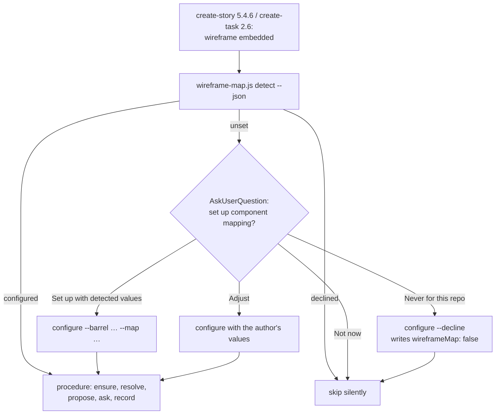

# Wireframe mapping setup offer and first-run candidates

**Status:** Planned
**GitHub Issue**: [#792](https://github.com/Gamaroff/agent-skills/issues/792)

---

## 1. Overview

Task 243 shipped wireframe → component mapping as an opt-in feature: a project that writes a `ui:`
block into `skills-config.yaml` gets every Wireloom node resolved to one of its components. This
task makes the feature find its users and makes its first run useful. When `create-story` or
`create-task` adds a wireframe and the project has no `ui:` block, the skill detects the project's
components, asks once whether to set mapping up, and writes the block (or a remembered "never")
through the engine. `resolve` then offers candidates drawn from the catalogue when the map has none,
and the map's hand-written rows get a guide.

**Scope**: three parts, one task. (a) the setup offer in the two authoring skills, backed by two
new engine commands, `detect` and `configure`, and a `declined` state; (b) catalogue-derived
candidates in `resolve`; (c) a "Writing map rows by hand" guide in the procedure, the configuration
reference and the seeded map header, documenting the sibling-context and icon-glyph limits.

**Key deliverables**

1. `wireframe-map.js detect` (read-only) and `configure` (writes the `ui:` block or a decline), and
   `reason: declined` from every command when `ui.wireframeMap` is `false` or `off`.
2. `create-story` 5.4.6 and `create-task` 2.6 offer setup when the engine reports `unset`, and stay
   silent when it reports `declined`.
3. `resolve` returns catalogue-derived candidates, marked `source: catalogue`, for an open node no
   map row nearly matches.
4. A "Writing map rows by hand" section with worked example rows and the two documented limits.

**Expected outcome**: a consumer who has never heard of the `ui:` block is offered mapping the first
time it would help, answers one question, and the first story after setup is proposed components
from the catalogue rather than from the agent's reasoning alone.

---

## 2. Motivation

### Current Problems

1. **The feature is invisible.** Without a `ui:` block every skill skips the mapping step and says
   nothing (procedure `wireframe-component-mapping.md:7`, *Off unless configured*; `create-story`
   5.4.6 step 3 at `skills/create-story/SKILL.md:762` and `create-task` 2.6 step 3 at
   `skills/create-task/SKILL.md:511`: "otherwise skip silently"). A consumer learns about it only
   from release notes.
2. **The one manual step needs knowledge the consumer does not have.** Five keys and two file paths
   (`docs/reference/configuration.md:236`, the `ui:` example). The `rebirth-wallet` confirmation of
   v0.62.0 (2026-10-29) needed an agent that had read the handoff to write it.
3. **A first run proposes nothing.** `resolve`'s candidates come only from map rows that nearly
   matched (`nearMisses`, `shared/resources/wireframe-map.js:458`). On an empty map every open node
   has `candidates: []`; the confirmation saw this on all 37 nodes of its first story.
4. **There is no way to say "never".** `readUiConfig` (`wireframe-map.js:107`) reads
   `wireframeMap: false` as unset (its `str()` helper returns `null` for a non-string) and
   `wireframeMap: off` as a map file literally named `off` (`parseYamlSubset("ui:\n  wireframeMap:
   off")` returns the string `"off"`, checked 2026-10-29). Once the skills offer setup, a repository
   with no component library would be asked on every story.
5. **Hand-written rows have no guide, and two limits are undocumented.** The seeded header
   (`MAP_HEADER`, `wireframe-map.js:70`) states the column formats but shows no filled-in row. The
   confirmation found that a signature cannot express sibling context (`row>text[bold]` is a page
   title only beside a `backbutton`) and that one Wireloom icon glyph stands for several design
   icons.

### Benefits

1. **Adoption without reading docs**: the offer appears the first time a wireframe is added, with
   detected values to accept.
2. **One decision, remembered**: "Never for this repo" is written to config and every skill honours
   it, so a backend or CLI repository is asked once.
3. **A useful first story**: catalogue-derived candidates give the agent and the author a short
   list to choose from on an empty map.
4. **Deterministic config writes**: the engine writes the block and reads it back, like `ensure`
   and `record` do for the map; no agent hand-edits YAML.
5. **Hand edits that work**: a person who edits the map knows how specific to be and what the
   format cannot say.

---

## 3. Technical Background

### Current Architecture

The engine `shared/resources/wireframe-map.js` (997 lines, bundled into eight skills as
`references/wireframe-map.js`: create-story, create-task, develop-story, develop-task, review-story,
review-task, qa-story, qa-task) has three commands, dispatched by `runCli` (`wireframe-map.js:925`):

- `ensure` (`:619`) creates a missing catalogue from `ui.componentBarrel` (`barrelExports`, `:557`)
  and a missing map (`createMap`, `:606`), and returns `reason: unset` when neither
  `componentCatalogue` nor `wireframeMap` is set (`:622`).
- `resolve` (`:712`) returns `reason: unset` when `wireframeMap` is not set (`:714`), and for each
  open node `candidates: nearMisses(rows, node)` (`:768`), filtered to names the catalogue lists
  (`catalogued`, `:494`, which reads the first cell of each table row under `ui.catalogueSection`).
  It reports `catalogueState` (`ok | no-section | missing | unset`).
- `record` (`:791`) appends or replaces one map row.

Config is read by `readUiConfig` (`:107`) through `parseYamlSubset` (`shared/resources/yaml-subset.js`).
Nothing in the repository writes `skills-config.yaml` except `scripts/setup-consumer.sh`'s wizard;
`grep -rn 'writeFileSync.*skills-config' shared/resources scripts skills/*/scripts` finds only tests.

The authoring skills run the procedure only when `ui.wireframeMap` is set
(`skills/create-story/SKILL.md:762`, `skills/create-task/SKILL.md:511`). Both skills' **Allowed
writes** lists (`skills/create-story/SKILL.md:50`, `skills/create-task/SKILL.md:88`) name only the
work-item directory, `sprint-status.yaml` and the tracker issue. They do not name the map and
catalogue files that task 243's step 3 already writes through `ensure` and `record`. That gap
predates this task, and this task closes it.

The develop pipelines resolve in Phase 0 but write nothing there: "their Phase 0 runs before the
branch exists and must leave the tree clean" (`wireframe-component-mapping.md:56`).

### Target Architecture

- **`declined` state.** `readUiConfig` reads `ui.wireframeMap: false` (boolean) or `off` (any case)
  as a decline. `ensure`, `resolve` and `record` return `reason: declined`, exit 0, and write
  nothing. A decline is not `unset`: `unset` invites the offer, `declined` silences it.
- **`detect`** (read-only, always exit 0 unless usage): reports `state` (`configured | declined |
  unset`) and, when `unset`, a `proposal` with each value and the evidence for it:
  - `componentBarrel`: the first candidate barrel that exports at least one component, from a fixed
    list (`src/components/index.{ts,tsx,js,jsx}`, `components/index.*`, `src/ui/index.*`) plus each
    workspace package (`packages/*/src/index.*`, `libs/*/src/index.*`) ranked by its count of
    component exports (`barrelExports`);
  - `componentImport`: the `name` of the nearest `package.json` above the barrel when it is a
    workspace package, else a `tsconfig.json` `compilerOptions.paths` alias that resolves to the
    barrel, else `null` with the reason;
  - `componentCatalogue` and `catalogueSection`: an existing Markdown file under `docs/` whose table
    lists, in its first column, backticked names matching at least three of the barrel's exports,
    and the heading above that table; else the defaults (`docs/architecture/components.md`,
    `## Components`);
  - `wireframeMap`: `docs/architecture/wireframe-component-map.md`.

  `reason: nothing-found` when no barrel qualifies; the skill then offers only Adjust, Not now and
  Never.
- **`configure`** appends a `ui:` block to `skills-config.yaml` (creating the file when it is
  missing), keeping the existing bytes and line ending. `--decline` writes `ui:` with
  `wireframeMap: false`. It refuses with `reason: exists` (exit 1, nothing written) when the file
  already has a top-level `ui:` key, whatever its value. It refuses a value holding a line
  terminator. After writing it re-reads the file with `readUiConfig`. If the values do not read
  back, it restores the original bytes and returns `reason: write-failed` (exit 1).
- **Catalogue candidates.** `catalogued` gains a sibling, `catalogueEntries`, that returns
  `{ name, text }` per row (`text` = the row's other cells, for a word match). For an open node,
  `resolve` returns near-miss candidates first, each now marked `source: "map"`. Then come up to
  five catalogue entries not already listed, marked `source: "catalogue"` and `basis: "name"` or
  `"purpose"`:
  - `name`: a PascalCase segment of the name equals the primitive, case-insensitive (`button` →
    `Button`, `IconButton`; `ButtonGroup` matches too, as a segment);
  - `purpose`: the row's text contains the primitive as a whole word.

  Catalogue candidates are offered only when `catalogueState` is `ok`. They are proposals. Nothing
  is recorded until the author confirms one.

### Important Clarifications

- **Authoring skills only.** Only `create-story` and `create-task` offer setup or call `configure`.
  The develop pipelines never do. Their Phase 0 must leave the tree clean
  (`wireframe-component-mapping.md:56`), and a `--defaults` run has nobody to ask. When they read
  `unset` or `declined` they skip, as today.
- **The config write is a tracked change.** The authoring skill names `skills-config.yaml` in its
  completion message as a change to commit with the work item, beside the map and catalogue
  `ensure` creates.
- **"Not now" writes nothing**, so the next wireframe asks again. Only "Never" is remembered.
- **Existing maps keep their header.** `ensure` never overwrites a map, so the new `MAP_HEADER`
  reaches only maps created after this ships. The procedure's guide is what existing consumers
  read.
- **Correction to an earlier claim.** In this session's design discussion, the reason the develop
  pipelines must not write config was attributed to `bug.6`. That was wrong: `bug.6` is the
  snippet classifier. The rule is the procedure's Phase 0 clean-tree rule, cited above.

---

## 4. Scope

### In Scope

- ✅ `wireframe-map.js`: the `declined` state, the `detect` and `configure` commands,
  `catalogueEntries` and catalogue candidates in `resolve`, `source` on every candidate, and an
  updated `MAP_HEADER` with example rows.
- ✅ `create-story` 5.4.6 step 3 and `create-task` 2.6 step 3: the setup offer. Both skills'
  **Allowed writes** lists gain the map, the catalogue and the `ui:` block in `skills-config.yaml`,
  each conditional on the mapping step.
- ✅ `wireframe-component-mapping.md`: *Off unless configured* rewritten, the decline rule, step 4
  naming catalogue candidates, and a new "Writing map rows by hand" section.
- ✅ `docs/reference/configuration.md` § "UI — wireframes and components": the setup offer, the
  decline value, and a pointer to the guide.
- ✅ Tests in `shared/resources/tests/wireframe-map.test.mjs`, `npm run bundle`, and a CHANGELOG
  entry.

### Out of Scope

- ❌ Offering setup from the develop pipelines, `review-*`, `qa-*` or `review-pr`. They have no
  author present, or must not write.
- ❌ A synonym table (`toggle` → `Switch`, `input` → `TextField`). Name and purpose matching first;
  a synonym table is a follow-up if confirmations show it is needed.
- ❌ Extending the signature grammar to express sibling context. The guide documents the label
  pattern workaround instead.
- ❌ Changing `setup-consumer.sh`'s wizard. The offer happens at first use, not at install.
- ❌ Rewriting the header of existing maps.

---

## 5. Breaking Changes

### Breaking Change 1: `ui.wireframeMap: false` and `off` change meaning

- **Before**: `false` read as unset; `off` read as a map file named `off` in the repository root.
- **After**: both read as a decline, and every command answers `reason: declined`.
- **Impact**: a consumer whose map file is literally named `off`. No known consumer has one.
- **Migration**: rename the map file and point `wireframeMap` at the new path.

### Breaking Change 2: candidates carry a `source` field and may be non-empty on an empty map

- **Before**: `unresolved[].candidates[]` held `{component, variant, from}` from map rows only.
- **After**: each candidate also has `source` (`map` or `catalogue`). Catalogue candidates have
  `basis` and `from: "catalogue"`.
- **Impact**: a caller that treated any candidate as a near-miss row. The procedure is the only
  caller and is updated in the same change.
- **Migration**: read `source`. Additive for JSON readers that ignore unknown fields.

---

## 6. Implementation Plan

> Detailed implementation guide: [task.246.plan.wireframe-mapping-setup-offer.md](task.246.plan.wireframe-mapping-setup-offer.md)

### Phase 1: Engine: the decline state, `detect` and `configure`

**Risk**: Medium (writes `skills-config.yaml`)
**Files**: `shared/resources/wireframe-map.js`, `shared/resources/tests/wireframe-map.test.mjs`

- [ ] `readUiConfig` returns `{ declined: true }` for `wireframeMap: false` or `off` (any case);
      `ensure`, `resolve` and `record` return `reason: declined` and write nothing
- [ ] `detect`: `state` plus, when `unset`, a `proposal` with evidence per field; `nothing-found`
      when no barrel qualifies; read-only
- [ ] `configure --barrel --import --catalogue --section --map [--exclude]` and
      `configure --decline`: append the block, keep bytes and line ending, refuse `exists`, refuse
      line terminators, read back and restore on `write-failed`
- [ ] `USAGE`, `parseArgs`, `runCli` and `human()` cover both commands
- [ ] Tests for each, mutation-proven

**Dependencies**: none

### Phase 2: Engine: catalogue-derived candidates

**Risk**: Low
**Files**: `shared/resources/wireframe-map.js`, `shared/resources/tests/wireframe-map.test.mjs`

- [ ] `catalogueEntries(text, heading)` returns `{ name, text }` per row; `catalogued` keeps its
      contract
- [ ] Near-miss candidates gain `source: "map"`
- [ ] `resolve` appends up to five catalogue candidates (`source: "catalogue"`, `basis`) not already
      listed, only when `catalogueState` is `ok`
- [ ] Tests for each, mutation-proven

**Dependencies**: none (independent of Phase 1)

### Phase 3: Skills: the setup offer

**Risk**: Medium (prose that drives a write)
**Files**: `skills/create-story/SKILL.md`, `skills/create-task/SKILL.md`,
`shared/resources/wireframe-component-mapping.md`

- [ ] `create-story` 5.4.6 step 3 and `create-task` 2.6 step 3 run `detect --json` and branch on
      `state`. `configured` runs the procedure. `declined` skips silently. `unset` asks one
      `AskUserQuestion` (Set up with detected values (Recommended), Adjust, Not now, Never for this
      repo), then runs `configure` and continues into the procedure, or skips
- [ ] Both **Allowed writes** lists name the map, the catalogue and the `ui:` block, conditional on
      the mapping step; the completion message names each as a change to commit
- [ ] The procedure's *Off unless configured* paragraph states the three states and who may offer
      setup

**Dependencies**: Phase 1

### Phase 4: Documentation: writing map rows by hand

**Risk**: Low
**Files**: `shared/resources/wireframe-component-mapping.md`, `docs/reference/configuration.md`,
`shared/resources/wireframe-map.js` (`MAP_HEADER`)

- [ ] Procedure step 4 names catalogue candidates and their `basis`
- [ ] New section "Writing map rows by hand", with worked example rows: a variant row, a
      label-pattern row, an icon row and a `(layout)` row. It covers how specific a signature
      should be, the sibling-context limit and its label-pattern workaround, and the icon-glyph
      rule (record the component, read the icon name from the design source)
- [ ] `configuration.md` § "UI — wireframes and components": the setup offer, `wireframeMap: false`,
      and a pointer to the guide
- [ ] `MAP_HEADER` gains two example rows and one line pointing at the procedure's guide

**Dependencies**: Phase 2 (step 4 describes its output)

### Phase 5: Bundle, changelog and verification

**Risk**: Low

- [ ] `npm run bundle`, then `npm run bundle:check` clean
- [ ] CHANGELOG `[Unreleased]`: Added (setup offer, catalogue candidates) and Changed
      (`wireframeMap: false|off` means declined)
- [ ] `npm run ci:fast` green; doc links checked on every changed `.md`

**Dependencies**: Phases 1–4

---

## 7. Files Summary

### Files to Modify (Core Implementation)

1. ✅ `shared/resources/wireframe-map.js`: decline state, `detect`, `configure`,
   `catalogueEntries`, candidate `source`, `MAP_HEADER`
2. ✅ `skills/create-story/SKILL.md`: 5.4.6 step 3, Allowed writes
3. ✅ `skills/create-task/SKILL.md`: 2.6 step 3, Allowed writes

### Files to Modify (Tests)

4. ✅ `shared/resources/tests/wireframe-map.test.mjs`: 29 tests today
   (`grep -c 'test(' shared/resources/tests/wireframe-map.test.mjs`)

### Files to Modify (Dependencies)

None. No `package.json` change.

### Files to Modify (Documentation)

5. ✅ `shared/resources/wireframe-component-mapping.md`
6. ✅ `docs/reference/configuration.md`
7. ✅ `CHANGELOG.md`
8. ✅ Generated: `skills/{create-story,create-task,develop-story,develop-task,review-story,review-task,qa-story,qa-task}/references/wireframe-map.js`
   and the procedure's bundled copies, refreshed by `npm run bundle` and never edited by hand.
   The skill list comes from `grep -l 'wireframe-map.js' skills/*/SKILL.md`.

### Files to Delete

None.

---

## 8. Testing Strategy

### Unit Tests

- **Scope**: every new branch in `wireframe-map.js`, each in a temporary project directory.
- **Command**: `command node --test shared/resources/tests/wireframe-map.test.mjs`
- **Cases**:
  - decline: `false`, `off`, `OFF` → `declined` from `ensure`, `resolve` and `record`, with no
    file written. **Control**: `wireframeMap: offline.md` is a path, not a decline.
  - `detect`:
    - a fixture with `src/components/index.ts` exporting three components returns that barrel;
    - a workspace package wins by component count, and its `package.json` name becomes
      `componentImport`;
    - an existing catalogue table matching three or more exports is proposed with its heading;
    - an empty project returns `nothing-found`;
    - a configured project returns `state: configured`, and a declined one `declined`;
    - **`detect` writes nothing**: snapshot the tree before and after.
  - `configure`:
    - appends to an existing file and keeps its bytes;
    - keeps CRLF;
    - creates a missing file;
    - refuses `exists` on a file with any top-level `ui:`;
    - refuses a newline in a value;
    - `--decline` round-trips to `declined`;
    - **read-back failure restores the original bytes**: force a mismatch with a value
      yaml-subset reads differently.
  - candidates:
    - an empty map with a catalogue holding `Button`, `IconButton` and `Card` gives a `button`
      node `Button` and `IconButton` (`basis: name`), not `Card`;
    - a purpose cell naming "button" gives `basis: purpose`;
    - at most five catalogue candidates;
    - near-miss candidates come first and are not duplicated;
    - `catalogueState: no-section` gives no catalogue candidates.

### Integration Tests

- The CLI is exercised through `runCli` with `--json` for `detect` and `configure`, asserting exit
  codes (0, 1 for `exists` and `write-failed`, 2 for usage).

### Contract Tests

- `npm run bundle:check` asserts every bundled copy matches its source.

### Performance Tests

Not applicable. `detect` walks at most the fixed barrel list plus the workspace packages' entry
files.

### Consumer Tests

- After release, re-run the `rebirth-wallet` confirmation on a clone with the `ui:` block removed.
  Expect the offer, the detected values (barrel, import and the existing purpose-table catalogue
  and heading), and catalogue candidates on the first story. This is a manual check, recorded in
  this task's Notes.

### Behavioural Evidence Control

The candidate tests use component names that appear nowhere in this task's text (for example
`Pill`, `PillGroup` and a `chip` node). The rule is then shown to apply to names beyond the
examples it quotes. A correct instance it must leave alone is included: a catalogue name containing
the primitive in the middle of a segment (`Rebutton`), which must not match `button`.

---

## 9. Success Criteria

### Functional

- [ ] `resolve`, `ensure` and `record` return `reason: declined` and write nothing when
      `ui.wireframeMap` is `false` or `off` (Phase 1 states the branch)
- [ ] `detect` on a project with no `ui:` block and a `src/components/index.ts` exporting
      components returns `state: unset` and a `proposal` naming that barrel (Phase 1)
- [ ] `detect` writes no file in any state
- [ ] `configure` appends a `ui:` block that `readUiConfig` reads back with the given values, and
      refuses with `reason: exists` when a `ui:` key is present (Phase 1)
- [ ] `configure --decline` leaves a config for which `detect` returns `state: declined`
- [ ] On an empty map with `catalogueState: ok`, an open `button` node's candidates include each
      catalogued name with a `Button` segment, each with `source: catalogue` (Phase 2)
- [ ] `create-story` 5.4.6 and `create-task` 2.6 offer setup on `unset`, skip on `declined`, and run
      the procedure on `configured`; neither offers setup when no wireframe was added
- [ ] No develop pipeline step calls `detect` or `configure`:
      `grep -n 'wireframe-map.js \(detect\|configure\)' skills/develop-*/SKILL.md shared/resources/develop-pipeline-*.md`
      returns nothing

### Performance

- [ ] `detect` completes in under one second on this repository and on a fixture with five
      workspace packages
- [ ] `resolve`'s output for a node with near-miss rows is unchanged apart from the added
      `source: map`

### Code Quality

- [ ] Every new branch has a test, and each fix is mutation-proven (revert it, see its test go red)
- [ ] `npm run ci:fast` green; `npm run bundle:check` clean; `prettier --check` on changed files
- [ ] `npm run validate -- skills/create-story/` and `npm run validate -- skills/create-task/` pass

### Migration

- [ ] CHANGELOG `[Unreleased]` names the setup offer, catalogue candidates and the new meaning of
      `wireframeMap: false|off`
- [ ] `configuration.md` documents the decline value and the offer
- [ ] The procedure's "Writing map rows by hand" section exists and is linked from the map header

---

## 10. Risk Assessment

### High Risk Areas

1. **`configure` corrupts a consumer's `skills-config.yaml`**
   - **Probability**: Low. **Impact**: High (every skill reads this file).
   - **Mitigation**: append-only; keep bytes and line ending; refuse when `ui:` exists; read back
     through the same reader every skill uses; restore the original bytes on mismatch. Tests cover
     CRLF, a missing file and the restore path.
   - **Rollback**: `git checkout -- skills-config.yaml` in the consumer.

### Medium Risk Areas

1. **`detect` proposes the wrong barrel or import module**
   - **Mitigation**: the question shows each detected value with its evidence, and Adjust is
     always offered. `nothing-found` never guesses.
2. **The offer becomes a nag**
   - **Mitigation**: one question per run, only when a wireframe was just added; "Never" is
     persisted. "Not now" asks again by design. If that proves noisy, a follow-up can add a
     per-session memory.
3. **Catalogue candidates crowd the question**
   - **Mitigation**: capped at five, near-misses first, and the procedure still offers at most two
     alternatives beside the Recommended answer.

### Low Risk Areas

1. **A map file named `off`** changes meaning. No known consumer has one, and the CHANGELOG names it.
2. **Bundled copies drift**. `bundle:check` in CI catches it.

---

## 11. Rollback Plan

### Immediate Rollback (< 1 hour)

- **Triggers**: a consumer's `skills-config.yaml` is damaged by `configure`, or `detect` writes a
  file.
- **Steps**: revert the merge commit on `develop`, run `npm run bundle`, release a patch.
- **Validation**: `wireframe-map.test.mjs` back to its 29 tests and green; `bundle:check` clean.

### Partial Rollback (1-2 hours)

- **When**: the offer misbehaves but the engine is sound.
- **Steps**: revert the Phase 3 edits to the two `SKILL.md` files only. The engine commands stay,
  unused, and the skills return to "skip silently".

### Forward Fix (< 4 hours)

- **When**: a wrong detection heuristic or noisy candidates.
- **Approach**: adjust the candidate list or the cap, with a test for the case that misbehaved.

### Rollback Triggers

- **Critical**: any write by `detect`; any `configure` write that does not read back; an offer from
  a develop pipeline.
- **Non-critical**: a wrong proposal (Adjust covers it); a candidate list that is long or odd.

---

<!-- change-log-start -->
## Change Log

| Date       | Version | Description   | Author      |
| ---------- | ------- | ------------- | ----------- |
| 2026-10-29 | 1.0     | Initial draft, from the rebirth-wallet confirmation of v0.62.0 | create-task |
<!-- change-log-end -->

---

## Progress Tracking

### Phase 1: Engine: the decline state, `detect` and `configure`
- [ ] Decline state
- [ ] `detect`
- [ ] `configure`

### Phase 2: Engine: catalogue-derived candidates
- [ ] `catalogueEntries`
- [ ] Candidates in `resolve`

### Phase 3: Skills: the setup offer
- [ ] `create-story` 5.4.6
- [ ] `create-task` 2.6
- [ ] Procedure

### Phase 4: Documentation: writing map rows by hand
- [ ] Procedure guide
- [ ] `configuration.md`
- [ ] `MAP_HEADER`

### Phase 5: Bundle, changelog and verification
- [ ] Bundle, CHANGELOG, `ci:fast`

---

## References

- **Predecessor**: [task.243](../task.243.wireframe-component-mapping/task.243.wireframe-component-mapping.md), wireframe → component mapping (released in v0.62.0)
- **Procedure**: `shared/resources/wireframe-component-mapping.md`
- **Engine**: `shared/resources/wireframe-map.js`
- **Configuration**: [`docs/reference/configuration.md`](../../reference/configuration.md) § "UI — wireframes and components"
- **Source**: consumer confirmation report of agent-skills v0.62.0 on `rebirth-wallet`
  (2026-10-29): verdict "worked", with three observations (empty first-run candidates, sibling
  context, icon glyphs) that this task answers

---

## Notes

### Important Reminders

- `configure` is the only writer of `skills-config.yaml` this repository's skills have. Keep it
  append-only and read-back-verified.
- Edit `shared/resources/` sources, never the bundled `references/` copies.
- The develop pipelines must not gain the offer. The success criterion's grep holds that.

### Known Issues

**Open** (Non-blocking):
- ⚠️ The full interactive `create-story` path on a real consumer is still unexercised. The v0.62.0
  confirmation ran the engine and procedure directly to avoid creating a tracker card. The consumer
  test in § 8 covers both.

### Future Improvements

- A synonym table for primitives whose components rarely share their name (`toggle` → `Switch`).
- A sibling or child constraint in the signature grammar, if label patterns prove insufficient.
- A per-session memory for "Not now".
