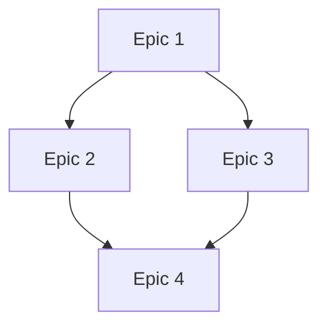

# Create Epics from PRD Shards

## When to Use This Skill

Activate this skill when:

- PRD has been sharded using `shard-prd`
- Need to convert PRD documentation into actionable development epics
- Building comprehensive system requiring multiple coordinated phases
- Want traceability from PRD sections to implementation epics

**Natural activation triggers:**

- "Create epics from the sharded PRD"
- "Generate epic files from PRD shards"
- "Convert PRD shards to implementation epics"

**Prerequisites:**

- PRD must be sharded first (using `shard-prd`)
- Shards exist in the PRD's own directory (`${PRD_ROOT}/{domain}/prd.{P}.{feature}/` — `${PRD_ROOT}` resolves to `docs/prd` by default; source `references/resolve-paths.sh` to override)
- Understanding of system architecture and dependencies
- **CRITICAL**: every epic is numbered **within this PRD** (`epic.{P}.{E}`); `E` is allocated by `references/doc-id.js` in Step 4, never by hand and never from a registry

**Do NOT use for:**

- PRDs that haven't been sharded (shard first)
- Single-epic scenarios (brownfield typically uses one epic)
- Stories without epic structure

## Purpose

Convert PRD shards into focused implementation epics:

- Creates `epics/` subdirectory in PRD folder
- Generates one epic file per major PRD shard
- Follows standard epic structure with stories, acceptance criteria, technical requirements
- Maintains traceability to source PRD shards
- Creates epic index with roadmap and dependencies

## Workflow Overview

```
1. Input Validation & Discovery
   ├─ Locate PRD shards directory
   ├─ Read index.md for structure
   └─ List all shard files

2. Shard Analysis & Epic Planning
   ├─ Assess complexity of each shard
   ├─ Identify natural epic boundaries
   ├─ Plan epic numbering and sequencing
   └─ Consider dependencies

3. Epic Creation Process
   ├─ For each shard → Create epic file
   ├─ Use standard epic structure
   ├─ Break down into stories
   └─ Define acceptance criteria and technical requirements

4. Epic Index Creation
   ├─ Create epics/index.md
   ├─ Roadmap with phases
   ├─ Dependency diagram
   ├─ Timeline estimates
   └─ Regenerate the parent PRD's epic index (prd.<feature>.md)

5. Quality Validation
   ├─ Verify all shards covered
   ├─ Check story sizing
   ├─ Validate dependencies
   └─ Ensure traceability

6. Handoff Documentation
   └─ Summary and next steps
```

## Detailed Execution Steps

### Step 1: Input Validation and Discovery

**Locate PRD Shards:**

- Identify PRD directory (user provides or prompt) — a `prd.{P}.{feature}/` directory
- Read `P` from its name (`command node .agents/skills/create-epics-from-shards/references/doc-id.js parse "prd.{P}.{feature}" --json | jq -r .prd`); **halt** if it does not parse as a PRD — every epic needs a PRD number, and `/create-prd` makes the PRD
- Verify sharded files exist
- Read `index.md` to understand structure
- List all shard files for processing

**Example structure:**

```
docs/prd/chat/prd.2.chat-system/
├── prd.2.chat-system.md        # The PRD (P = 2)
├── index.md                    # Overview
├── core-chat-integration.md    # Shard 1
├── payment-processing.md       # Shard 2
├── group-features.md          # Shard 3
└── epics/                     # Target directory
```

### Step 2: Shard Analysis and Epic Planning

For each shard, analyze:

**Complexity Assessment:**

- Feature scope and complexity level
- Integration points with other components
- Technical architecture requirements
- Development effort (1-3 epics vs single epic)

**Epic Identification:**

- Identify natural boundaries for epic creation
- Consider development dependencies and sequencing
- Assess if shard needs multiple epics or single epic
- Plan epic numbering and logical progression

### Step 3: Epic Creation Process

For each identified epic, create using this structure:

```markdown
---
prd_number: P # REQUIRED — the parent PRD's number (Step 1)
epic_number: E # REQUIRED — E within this PRD, allocated in Step 4. Drives the PRD epic index.
title: "[Epic P.E] Epic Name"
prd_source: "docs/prd/{domain}/prd.{P}.{feature}/prd.{P}.{feature}.md" # repo-relative path to the parent PRD (required)
epic_type: "system_implementation"
priority: "[high|medium|low]"
estimated_sprints: "[1-6]"
dependencies: ["epic.P.1", "epic.P.2"] # epic.{P}.{E} ids of the epics this one depends on
---

# [Epic P.E] Epic Name

## Epic Goal

[1-2 sentences: what this accomplishes and business value]

## Background & Context

**Source PRD Section:** [Original PRD section]
**System Integration:** [How fits into overall system]
**Prerequisites:** [What must be completed first]

## Epic Description

### What We're Building

[Detailed description of features and functionality]

### Why It Matters

[Business value and user impact]

### Success Criteria

- [ ] [Measurable outcome 1]
- [ ] [Measurable outcome 2]
- [ ] [Measurable outcome 3]

## Stories Breakdown

### Story 1: [Story Title]

**As a** [user type]
**I want** [functionality]
**So that** [benefit]

**Acceptance Criteria:**

- [ ] [Specific criterion 1]
- [ ] [Specific criterion 2]
- [ ] [Specific criterion 3]

**Technical Requirements:**

- [ ] [Technical task 1]
- [ ] [Technical task 2]

### Story 2: [Story Title]

[Repeat structure...]

## Technical Architecture

### Components Involved

- [Component 1]: [Role/responsibility]
- [Component 2]: [Role/responsibility]

### Database Changes

- [ ] [Table/model changes]
- [ ] [Migration requirements]

### API Changes

- [ ] [New endpoints]
- [ ] [Modified endpoints]

### Integration Points

- [ ] [External system integrations]
- [ ] [Internal service dependencies]

## Dependencies

**Depends On:**

- [ ] [Epic P.E] Epic name - [Reason]
- [ ] [External dependency] - [Reason]

**Blocks:**

- [ ] [Epic P.E] Epic name - [Reason]

## Risks & Mitigation

**Primary Risks:**

- **Risk**: [Description]
  - **Probability**: [High/Medium/Low]
  - **Impact**: [High/Medium/Low]
  - **Mitigation**: [Strategy]

## Definition of Done

- [ ] All user stories completed with acceptance criteria met
- [ ] Technical requirements implemented and tested
- [ ] Integration tests passing with dependent systems
- [ ] Documentation updated (API docs, user guides)
- [ ] Code review completed and approved
- [ ] Performance requirements met
- [ ] Security review completed (if applicable)
- [ ] Deployment to staging successful
- [ ] Product owner acceptance received

## Estimated Timeline

- **Planning**: [X days]
- **Development**: [X sprints]
- **Testing**: [X days]
- **Deployment**: [X days]
- **Total**: [X weeks]

## Success Metrics

- [Quantifiable metric 1]
- [Quantifiable metric 2]
- [User satisfaction measure]
```

### Step 4: Epic Naming and Organization

**CRITICAL — numbers come from `doc-id.js`, within the PRD:**

One `next epic` call gives the first free `E` in this PRD; the batch takes consecutive numbers from
it. Run it once, before writing any epic file:

```bash
# INPUT: {PRD dir} — substitute the PRD directory found in Step 1 (prd.{P}.{feature}/).
PRD_DIR="{PRD dir}"
[ -d "$PRD_DIR" ] || { echo "❌ ${PRD_DIR} is not a directory — substitute the PRD directory from Step 1"; exit 1; }
NEXT=$(command node .agents/skills/create-epics-from-shards/references/doc-id.js next epic --prd-dir "$PRD_DIR" --json) \
  || { echo "❌ doc-id next epic failed for ${PRD_DIR}: $(printf '%s' "$NEXT" | jq -r '.detail // .reason')"; exit 1; }
E0=$(printf '%s' "$NEXT" | jq -r '.next')
echo "E0=${E0}"   # epics of this batch: E0, E0+1, … E0+n-1
```

**Example:** PRD 2 already has epics `epic.2.1` and `epic.2.2`; `next epic` answers `3`; creating
three epics gives `epic.2.3`, `epic.2.4`, `epic.2.5`.

**File Naming Convention:**

- Format: `epic.{P}.{E}.{feature-name}.md` (NOTE: Use DOTS, not dashes)
- Lowercase with hyphens for descriptive names only; the name begins with a letter
- Example: `epic.2.3.basic-messaging.md` (NOT `epic-2-3-basic-messaging.md`, NOT `epic.3.basic-messaging.md`)

**Epic Directory** — one directory per epic, named like its file (the PRD epic index and `doc-id check`
both require this layout):

```
${PRD_ROOT}/{domain}/prd.{P}.{feature}/epics/
├── epic.2.3.core-infrastructure/epic.2.3.core-infrastructure.md
├── epic.2.4.basic-messaging/epic.2.4.basic-messaging.md
├── epic.2.5.payment-integration/epic.2.5.payment-integration.md
└── index.md  # Epic overview and roadmap
```

### Step 5: Create Epic Index

Create `epics/index.md`:

````markdown
# [System Name] Implementation Epics

## Overview

Implementation epics derived from [System Name] PRD shards. Each epic
represents focused development phase with clear deliverables.

## Epic Roadmap

### Phase 1: Foundation

- [Epic 2.3: Core Infrastructure](./epic.2.3.core-infrastructure/epic.2.3.core-infrastructure.md)

### Phase 2: Core Features

- [Epic 2.4: Basic Features](./epic.2.4.basic-features/epic.2.4.basic-features.md)
- [Epic 2.5: Integration Layer](./epic.2.5.integration-layer/epic.2.5.integration-layer.md)

### Phase 3: Advanced Features

- [Epic 2.6: Advanced Features](./epic.2.6.advanced-features/epic.2.6.advanced-features.md)

## Dependencies


````

## Development Timeline

- **Phase 1**: [Timeframe]
- **Phase 2**: [Timeframe]
- **Phase 3**: [Timeframe]
- **Total**: [X months]

## Success Metrics

- [System metric 1]
- [System metric 2]
- [User adoption target]

````

### Step 6: Regenerate the PRD Epic Index

After all epic files are written (Steps 3–4), refresh the parent PRD's linked epic index so PRD→epic links stay complete and
statuses current. This is the PRD-level index injected into `prd.<feature>.md` — distinct
from the epic roadmap `epics/index.md` created in Step 5; keep both.

1. Ensure `${PRD_ROOT}` is set — source the resolver if you have not already:

   ```bash
   source references/resolve-paths.sh   # sets PRD_ROOT (default docs/prd)
   ```

2. Run the generator, preferring the consumer's vendored copy and falling back to the
   skill's bundled reference when it is absent:

   ```bash
   node scripts/generate-prd-epic-index.mjs --prd-root "${PRD_ROOT}" \
     || node references/generate-prd-epic-index.mjs --prd-root "${PRD_ROOT}"
   ```

   Every new epic MUST carry `prd_number` and `epic_number` matching its directory (Step 3) —
   the generator skips, and names on stderr, any epic whose numbers disagree. Add `--strict` to
   turn a skip into a hard error when you want to fail loudly instead.

3. Stage the changed `prd.*.md` alongside the epic files in the **same** commit, so the
   downstream `docs:epic-index:check` never sees drift.

### Step 7: Quality Validation

**Id check (blocking)** — run on every epic of the batch; any `reason` other than `ok` is a HALT,
printed verbatim:

```bash
# INPUTS: {PRD dir} — the same PRD directory as Step 4; {E0} and {count} — this batch's first epic
# number (Step 4's E0) and how many epics it wrote. PRD_ROOT is resolved here (QA cycle 2, CR-7).
PRD_DIR="{PRD dir}"
E0="{E0}"; COUNT="{count}"
# Each input on its own: joined, one substituted value would cover a missing other (QA cycle 4, CR-5).
for v in "$E0" "$COUNT"; do
  case "$v" in ''|*[!0-9]*|0*) echo "❌ substitute {E0} and {count} with this batch's numbers (positive integers)"; exit 1 ;; esac
done
[ -d "$PRD_DIR/epics" ] || { echo "❌ ${PRD_DIR}/epics does not exist — substitute the PRD directory from Step 1"; exit 1; }
source .agents/skills/create-epics-from-shards/references/resolve-paths.sh || exit 1
CHECKED=0
for f in "$PRD_DIR"/epics/epic.*/epic.*.md; do
  [ -f "$f" ] || continue
  case "${f##*/}" in "$(basename "$(dirname "$f")").md") ;; *) continue ;; esac
  OUT=$(command node .agents/skills/create-epics-from-shards/references/doc-id.js check "$f" --prd-root "${PRD_ROOT}" --json) \
    || { echo "❌ doc-id check failed: $f"; printf '%s\n' "$OUT"; exit 1; }
  CHECKED=$((CHECKED + 1))
done
# Every epic of THIS batch must be present: a floor of "any epic" passes a batch that wrote nothing
# whenever the PRD already had epics (QA cycle 3, CR-3).
P=$(command node .agents/skills/create-epics-from-shards/references/doc-id.js parse "$(basename "$PRD_DIR")" --json | jq -r 'select(.kind == "prd") | .prd')
[ -n "$P" ] || { echo "❌ $(basename "$PRD_DIR") is not a prd.{P}.{feature} directory"; exit 1; }
E=$E0
while [ "$E" -lt $((E0 + COUNT)) ]; do
  # Exactly one epic.P.E.{slug}/epic.P.E.{slug}.md — the only shape the loop above checks, so a
  # misnamed batch file cannot pass unchecked (QA cycle 5, CR-1).
  FOUND=0
  for d in "$PRD_DIR/epics/epic.$P.$E."*/; do
    d=${d%/}
    [ -f "$d/${d##*/}.md" ] && FOUND=$((FOUND + 1))
  done
  [ "$FOUND" -eq 1 ] \
    || { echo "❌ epic.$P.$E is missing — the batch did not write one epic.$P.$E.{slug}/epic.$P.$E.{slug}.md (found $FOUND)"; exit 1; }
  E=$((E + 1))
done
echo "doc-id check: ${CHECKED} epic(s) ok; batch epic.$P.$E0 … epic.$P.$((E0 + COUNT - 1)) present"
```

**Epic Quality Checklist:**
- [ ] Epic has clear, measurable goal
- [ ] Stories properly scoped (not too large/small)
- [ ] Acceptance criteria testable
- [ ] Technical requirements specific
- [ ] Dependencies clearly identified
- [ ] Risks assessed with mitigation
- [ ] Success metrics quantifiable
- [ ] Timeline estimates realistic

**Overall Validation:**
- [ ] All PRD shard content covered
- [ ] Epic dependencies logical
- [ ] No gaps in functionality
- [ ] Epic scope balanced
- [ ] Total timeline realistic

### Step 8: Handoff Documentation

Create handoff summary:

```markdown
# Epic Creation Summary

**Source PRD**: [path]
**Shards Processed**: [N] shards
**Epics Created**: [N] epics
**Estimated Time**: [X months]

## Epic Overview

1. Epic 1: [Name] - [Description] ([X weeks])
2. Epic 2: [Name] - [Description] ([X weeks])
3. Epic 3: [Name] - [Description] ([X weeks])

## Next Steps

1. Review epics with development team
2. Prioritize epic sequence
3. Begin story refinement for Epic 1
4. Set up project tracking

## Development Team Handoff

Epics ready for:
- Effort estimation and planning
- Sprint planning and refinement
- Architecture review
- Resource allocation
````

## Integration with Other Skills

**Called by:**

- `shard-prd` - After sharding completion
- User request - Direct activation

**Requires:**

- `shard-prd` - Must be run first

**Leads to:**

- Story refinement workshops
- Sprint planning
- Architecture review

## Success Criteria

Successful epic creation produces:

1. **All shards covered** - Every PRD shard converted to epic(s)
2. **Standard structure** - All epics follow template
3. **Clear traceability** - Each epic references source shard
4. **Logical dependencies** - Epic sequence makes sense
5. **Quality validated** - All checks pass
6. **Index created** - Roadmap and timeline documented
7. **Handoff complete** - Summary and next steps clear

## Example Activation

```
User: "Create implementation epics from the sharded PRD"

→ create-epics-from-shards activates
→ Locates docs/prd/chat/prd.2.chat-system/ (P = 2)
→ Reads index.md (8 shards found)
→ Analyzes each shard for complexity
→ doc-id next epic --prd-dir … → 1 (no epics yet)
→ Creates 5 epics in docs/prd/chat/prd.2.chat-system/epics/, one directory each:
   - epic.2.1.core-infrastructure/epic.2.1.core-infrastructure.md
   - epic.2.2.basic-messaging/epic.2.2.basic-messaging.md
   - epic.2.3.payment-integration/epic.2.3.payment-integration.md
   - epic.2.4.group-features/epic.2.4.group-features.md
   - epic.2.5.advanced-features/epic.2.5.advanced-features.md
→ Creates epics/index.md with roadmap
→ Validates quality
→ Presents handoff summary
```

## Common Pitfalls to Avoid

❌ **One-to-one mapping** - Not every shard needs exactly one epic
❌ **Epic too large** - Break down if >6 sprints estimated
❌ **Missing dependencies** - Document all prerequisites
❌ **Vague success criteria** - Make measurable and testable
❌ **No traceability** - Always reference source PRD shard

✅ **Assess complexity first**
✅ **Plan epic boundaries carefully**
✅ **Document dependencies explicitly**
✅ **Size stories appropriately**
✅ **Maintain traceability**

## Notes

- Epics from shards are implementation-focused (not discovery)
- Each epic should deliver deployable, testable value
- Epic scope balances velocity with deliverable value
- Dependencies form logical development sequence
- Traceability to PRD shards is mandatory
